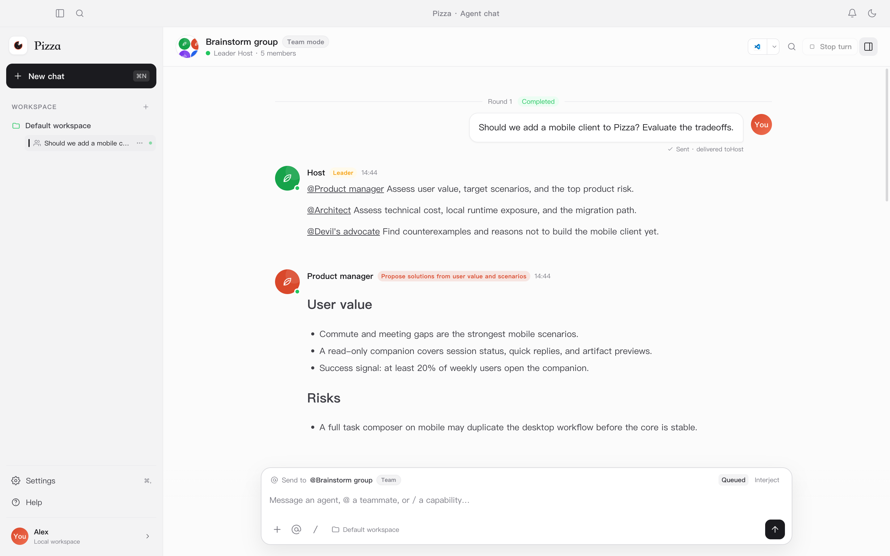
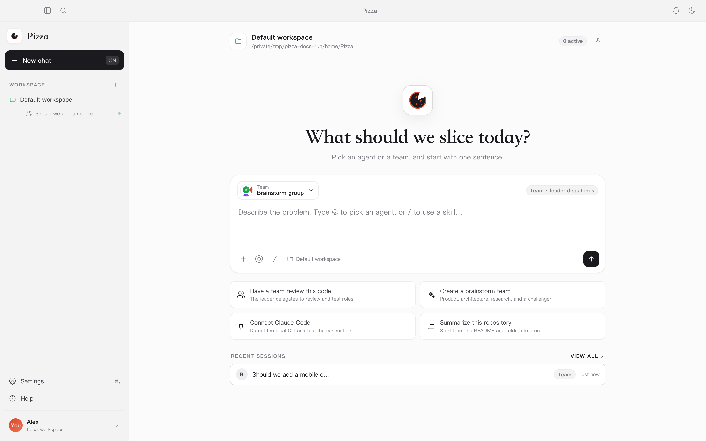
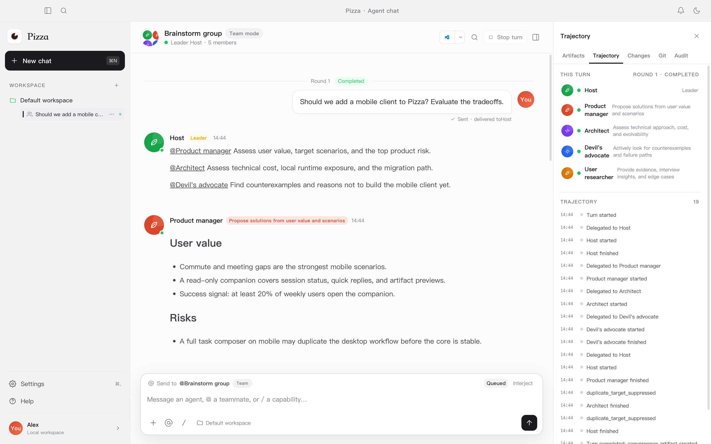
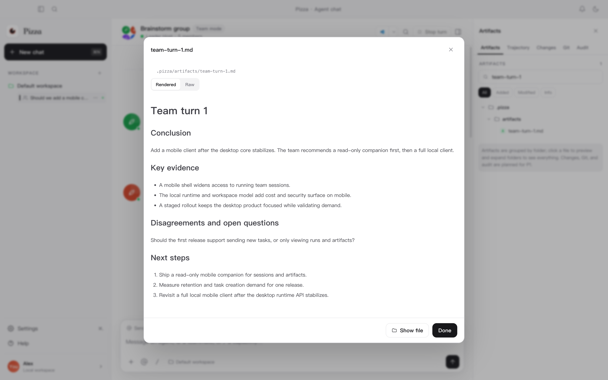
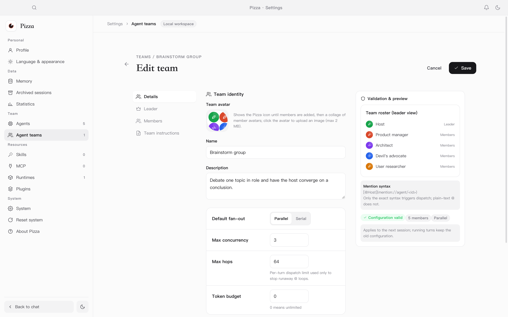
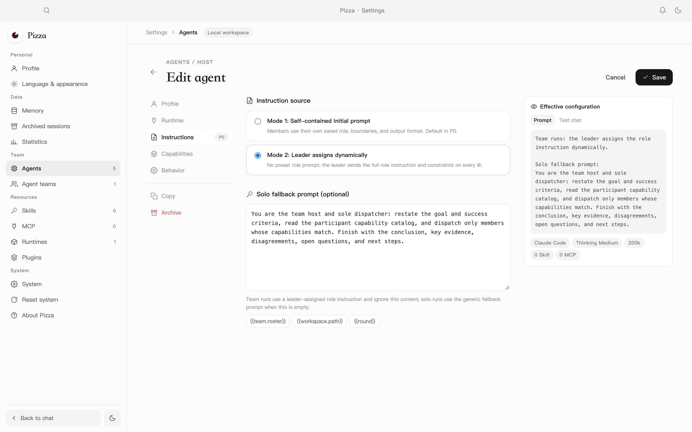
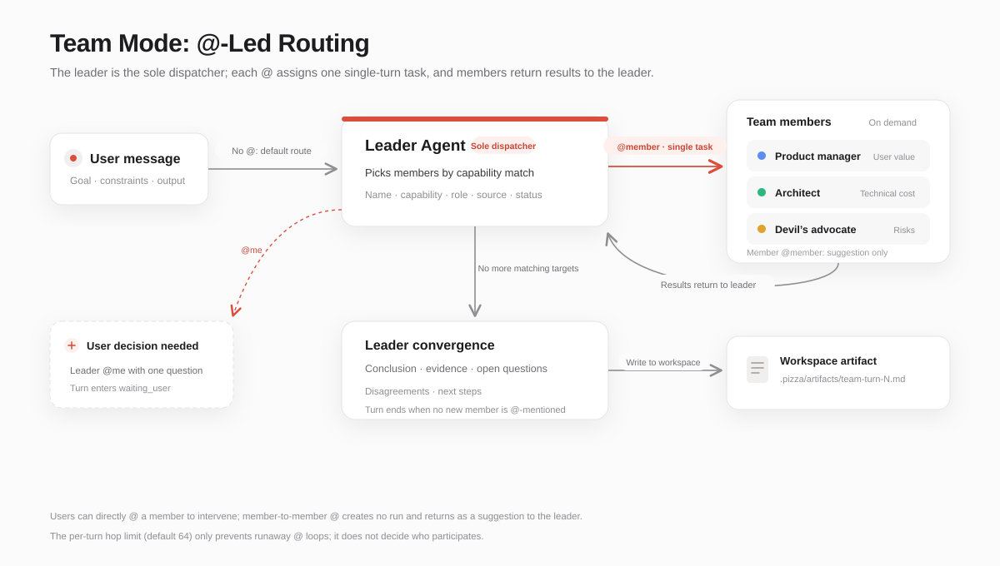

# Pizza

**A local-first multi-agent workspace**

[简体中文](README.zh.md) | English

**Two modes**: General mode gives you the power of a single agent such as Claude, Codex, or DSH. Team mode adds the ability to organize and dispatch multiple agents.

**Capabilities**: brainstorm, build software, run research meetings—anything you want to do.

## Product tour



*A team turn: the leader dispatches, members return results, and the turn converges into an artifact.*


### Start from one sentence

Choose a single agent or a team. In team mode, the leader takes over orchestration.



### Every dispatch is traceable

The Trace panel records participants, each dispatch, run status, user waits, and convergence events for the turn.



### Structured convergence becomes an artifact

The leader writes the conclusion, evidence, disagreements and open questions, and next steps to a Markdown artifact.



### Team configuration is the capability catalog

Member cards show capability descriptions, team roles, and instruction source. Dynamic-prompt members are marked "Dynamic instruction".



### Every agent can choose its instruction source

In mode 2, the initial prompt becomes an optional solo fallback; team runs receive their role instruction from the leader.



## Why Pizza

Large models are evolving quickly, and we keep looking for the best combination. In practice, a few problems remain:

1. The same model with different agents produces different results, and different models with the same agent also differ.
2. Different models are stronger in different domains.
3. Capability usually tracks price, so stronger models should lead while lighter models participate.

That is why we built Pizza: to organize models and agents so their strengths compound instead of canceling out.

## The core idea: @-led routing

Team mode does not put several agents into one chat window. It makes the **leader the sole dispatcher**.

- Participants register capabilities like Skills: name, capability description, team role, instruction source, and run status all go to the leader.
- The leader decides whom to `@` based on task fit. Each `@` assigns one **single-turn task**: goal, inputs, and completion criteria.
- Members return the result to the leader, who decides whether to dispatch again or converge.
- Member-to-member `@` creates no run. It returns to the leader as a suggestion; there is no direct member-to-member connection.
- Users can `@` a member directly, or be `@`-mentioned by the leader to make a decision. The turn waits for the user.
- When the leader stops mentioning new members and writes a summary, the turn ends and the structured result is saved as a workspace artifact.



The per-turn hop limit (default 64) only prevents runaway `@` loops; it does not decide member participation. The leader decides when to continue and when to converge.

### Instruction source: let strong models lead

Each agent can choose one of two instruction sources:

- **Self-contained prompt**: the member uses its saved role, boundaries, and output format; the leader only describes the task.
- **Leader-assigned prompt**: the member has no preset role prompt; the leader sends the full role instruction and constraints on every `@`.

This makes it possible to build teams by capability and cost: stronger models lead, lighter models participate.

## Features

- **Two session modes**: talk to a single agent, or let a leader organize several agents.
- **Multiple runtimes**: Claude Code, Codex, Pi/OMP, DSH, Hermes, OpenCode, Qoder CN, Gemini CLI, Kimi Code, ACP, and generic CLIs.
- **Capability access**: Skill import and management, MCP server configuration, tool approvals.
- **Local-first**: SQLite stores sessions, runs, and artifacts; data lives in `~/.pizza` by default.
- **Reliable execution**: streaming output, stop, retry, queueing, concurrency limits, and run audit.
- **Workspace artifacts**: files created or changed in a conversation are indexed with Markdown and code preview.
- **Desktop experience**: macOS, Windows, and Linux desktop apps with light/dark themes and Chinese/English UI.

## Installation

### Requirements

- macOS 13 or later
- Windows 10 or later
- A mainstream x64 Linux distribution (AppImage / deb)
- At least one local agent runtime: Claude Code, Codex, Pi/OMP, DeepSeek Harness, Hermes, OpenCode, Qoder CN, Gemini CLI, Kimi Code, or a generic ACP runtime
- A writable data directory; the default is `~/.pizza`

### Install

**macOS**

1. Download `Pizza-<version>-arm64.dmg` from the project release page.
2. Open the disk image and drag Pizza into Applications.
3. If macOS reports an unidentified developer on first launch, allow it in System Settings → Privacy & Security.

**Windows**

1. Download `Pizza-Setup-<version>.exe` or `Pizza-<version>-win.zip`.
2. Run the installer and follow the wizard. If SmartScreen warns about an unknown publisher, choose More info → Run anyway.

**Linux**

1. Download `Pizza-<version>.AppImage` or `Pizza-<version>.deb`.
2. For AppImage, make it executable and run it; for deb, install it with your system package manager.

The installer does not bundle or download model runtimes. Install and sign in to your runtime using its official documentation first.

## User guide

### 1. Connect a runtime

On first launch, Pizza detects available agent runtimes on your machine. Select the installed runtimes you want and choose Import selected; Pizza tests each connection and registers the ones that pass. You can also skip this step and configure runtimes later in Settings → Runtimes.

### 2. Create an agent

Open Settings → Agents → New agent. Enter a name, description, runtime, and initial prompt, and optionally choose a model, thinking level, and concurrency limit. The description is shown to the team leader as the agent's capability summary.

### 3. Chat with a single agent

Return to Home, choose an agent in the participant picker, and send a task. You can watch streaming output and tool calls, and stop or retry the run.

### 4. Create a team

Open Settings → Agent teams. Create a team from the brainstorm template or start from scratch. Choose the leader and members, fill in their roles and the team orchestration prompt, then save. The team becomes available on Home.

### 5. Run a team conversation

Choose the team and send a task. Without an `@`, the message goes to the leader. The leader reads the participant capability catalog, chooses members, and assigns single-turn tasks; members return results to the leader.

- The Trace panel shows participants, dispatches, run status, user waits, and convergence events for the turn.
- To intervene, `@` a member directly in the composer. When the leader `@`-mentions the user, the turn enters a waiting state.
- After convergence, the structured summary is saved under `.pizza/artifacts/` in the workspace and appears in the artifact panel.

### 6. Choose an instruction source

In the agent editor's Instructions tab, choose:

- **Self-contained prompt**: the member uses its saved role and output format.
- **Leader-assigned prompt**: the member has no preset role prompt; the leader sends the full role instruction on every `@`.

Mode 2 is useful when building teams by model capability: stronger models lead, lighter models participate.

### 7. Settings and data

- Settings → Language & appearance switches theme and UI language.
- Settings → Runtimes / Skills / MCP manages runtimes and capabilities.
- Settings → Archived sessions restores or permanently deletes sessions.
- Data is stored in `~/.pizza` by default. You can migrate it in Settings or set `PIZZA_DATA_DIR`.
- Shortcuts: `⌘K` command palette, `⌘N` new chat, `⌘,` open settings.

## Build from source

Requirements: Node.js 22+ and npm.

```bash
npm install
npm run dev            # development
npm run build          # production build
npm run package:mac    # create macOS dmg/zip
npm run package:win    # create Windows nsis/zip
npm run package:linux  # create Linux AppImage/deb
```

Build artifacts are written to `release/`. See [docs/USAGE.md](docs/USAGE.md) for the full development, test, and packaging guide.

## Documentation

- [Usage](docs/USAGE.md)
- [Changelog](CHANGELOG.md)
- [Team protocol](docs/TEAM-PROTOCOL.md)
- [Message routing](docs/MESSAGE-ROUTING.md)
- [Product requirements](docs/PRD.md)
- [Implementation notes](docs/IMPLEMENTATION.md)

## License

Pizza is released under the [Apache License 2.0](LICENSE).

You may use, modify, and distribute the project, provided you retain the copyright and license notices and include a copy of the license with distributions. See [LICENSE](LICENSE) for the full terms.
