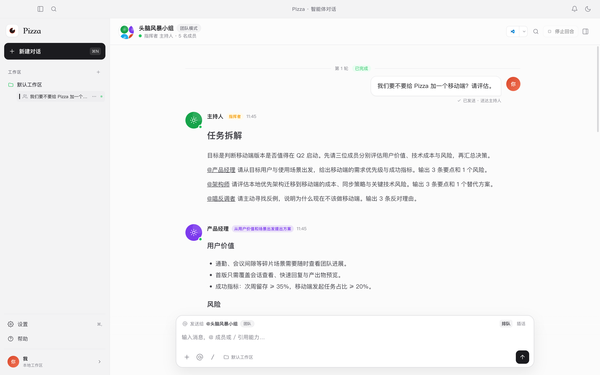
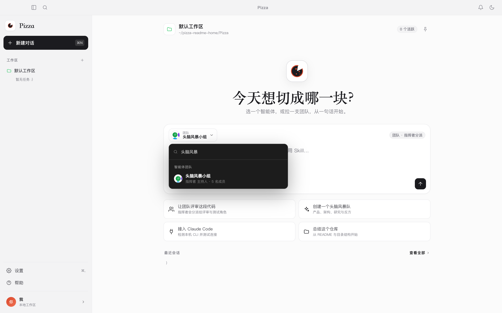
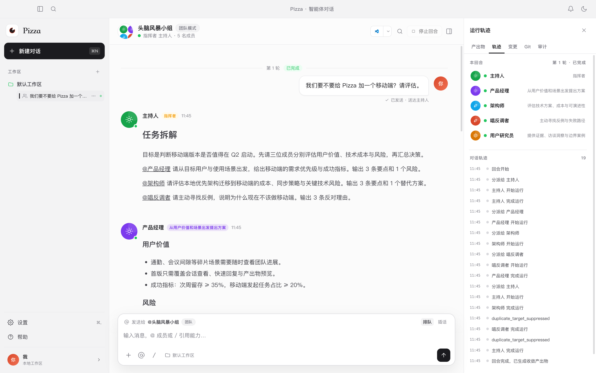
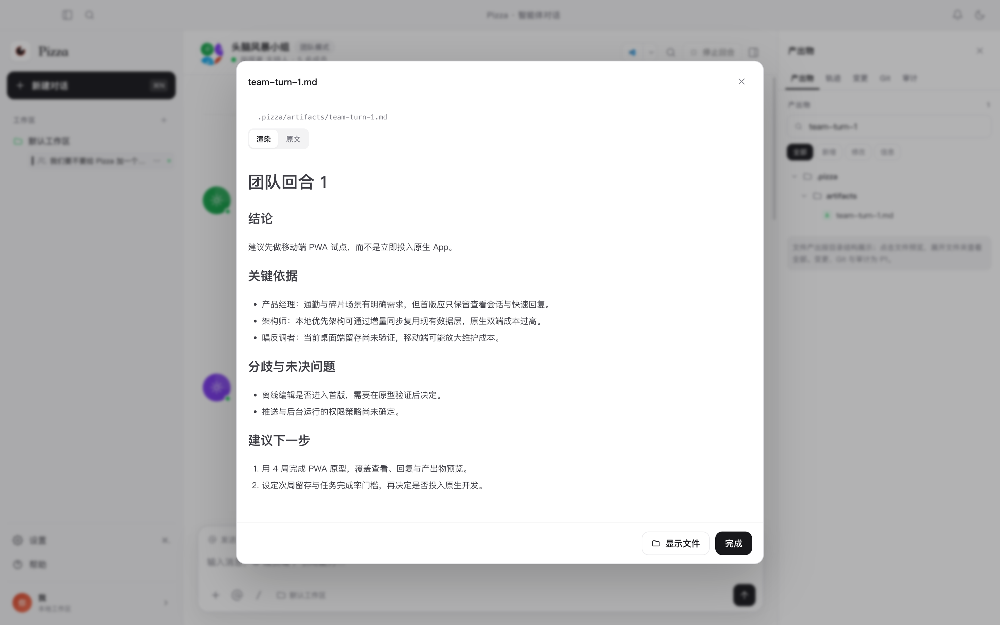
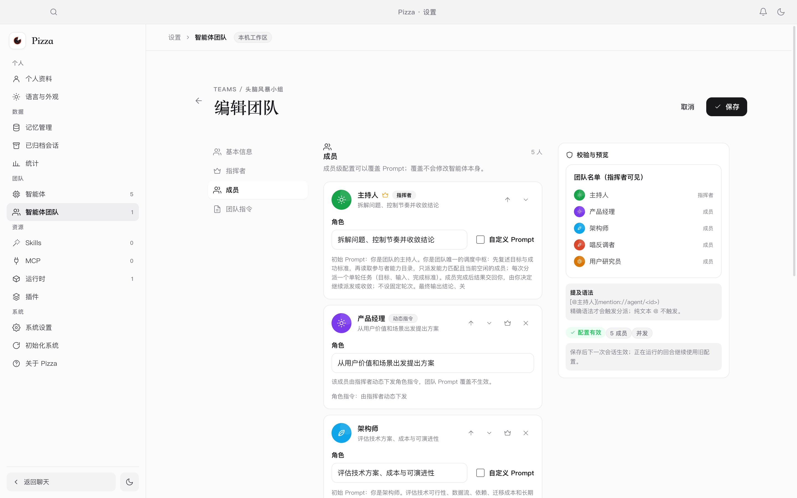
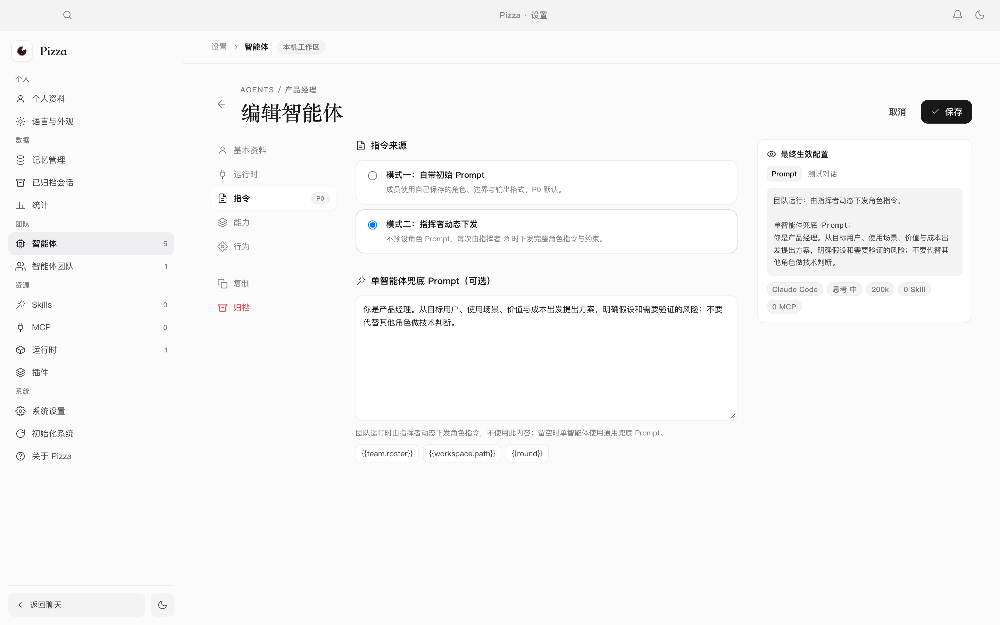
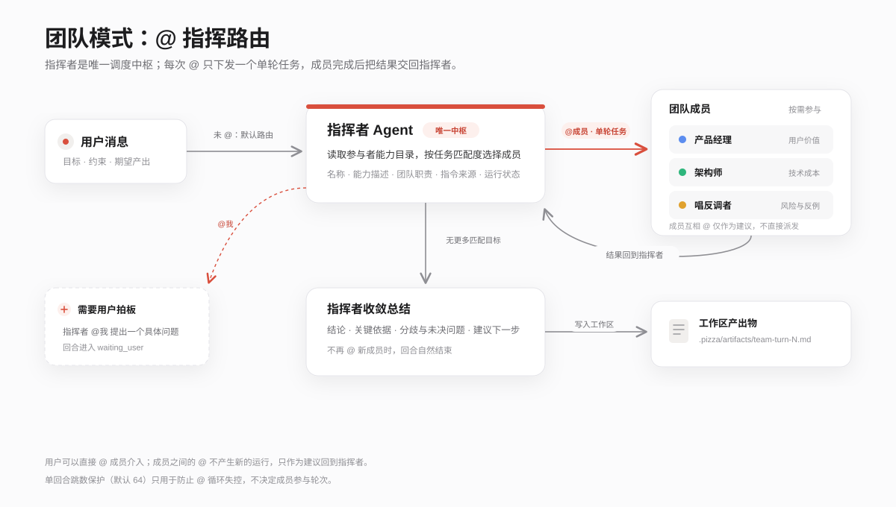

# Pizza

**本地优先的多智能体协作工作台**

简体中文 | [English](README.md)

**两种智能模式**：一般模式具备 Claude、Codex、DSH 等单 Agent 的能力；团队模式则具备组织、调度多个 Agent 的能力。

**能力**：头脑风暴、开发软件、召开科研会议——做任何你想做的事。

## 产品一览



*一次团队回合：指挥者分派任务，成员回传结果，最终收敛为产出物。*

### 从一句话开始

选择单智能体，或选择一支团队；团队模式会由指挥者接管后续编排。



### 每一次调度都可追踪

右侧「轨迹」记录本回合的参与者、每次分派、运行状态、等待用户与收敛事件。



### 结构化收敛为产出物

指挥者输出结论、关键依据、分歧与未决问题、建议下一步，并保存为工作区 Markdown。



### 团队配置就是能力目录

成员卡片展示能力描述、团队职责与指令来源；动态指令成员会标注「动态指令」。



### 每个智能体都能选择指令来源

模式二下，初始 Prompt 变为可选的单智能体兜底 Prompt，团队运行完全由指挥者动态下发角色指令。



## 为什么做 Pizza

当前大模型快速发展，我们总想找到最优的组合，但现实中存在几个问题：

1. 不同模型搭配相同 Agent，最终能力不同；相同模型搭配不同 Agent，最终能力也不同。
2. 不同模型在不同领域的表现各有长短。
3. 模型能力与价格通常成正比，因此应当让能力强的模型担任领导者，能力一般的模型担任参与者。

基于以上考虑，为了更好地组织和发挥模型的能力，我们开发了这款软件。

## 核心亮点：@ 指挥路由

团队模式不是把多个 Agent 拉进同一个聊天窗口，而是让**指挥者成为唯一的调度中枢**。

- 参与者像 Skill 一样登记能力：名称、能力描述、团队职责、指令来源与运行状态统一交给指挥者。
- 指挥者按任务匹配度自主决定 `@` 谁，每次 `@` 只下发一个**单轮任务**：目标、输入、完成标准。
- 成员完成本次任务后把结果交回指挥者，由指挥者决定继续派发还是收敛。
- 成员之间的 `@` 不产生新的运行，只作为建议随结果回到指挥者；不做跨成员直连。
- 用户可以直接 `@` 成员介入，也可以被指挥者 `@` 来拍板；回合会等待用户回复。
- 指挥者不再 `@` 新成员并输出总结时，回合自然结束，结构化总结自动写入工作区产出物。



单回合跳数保护（默认 64）只用于防止 `@` 循环失控，不决定成员参与轮次。是否继续辩论、什么时候收敛，由指挥者根据任务进展决定。

### 指令来源：让强模型做指挥者

每个智能体可以选择两种指令来源：

- **自带初始 Prompt**：成员使用自己保存的角色、边界与输出格式，指挥者只描述任务。
- **指挥者动态下发**：成员不预设角色 Prompt，每次由指挥者 `@` 时下发完整角色指令与约束。

这让团队可以按模型能力与成本分层组合：能力强的模型担任领导者，能力一般的模型担任参与者。

## 功能

- **双模式会话**：单智能体直接对话，或由指挥者组织多个 Agent 协作。
- **多运行时**：Claude Code、Codex、Pi/OMP、DSH、Hermes、OpenCode、Qoder CN、Gemini CLI、Kimi Code、ACP 与通用 CLI。
- **能力接入**：Skill 导入与管理、MCP Server 配置、工具审批。
- **本地优先**：SQLite 保存会话、运行与产出物；数据默认位于 `~/.pizza`。
- **可靠执行**：流式输出、停止、重试、排队、并发上限与运行审计。
- **工作区产出物**：对话中生成或修改的文件自动索引，支持 Markdown 与代码预览。
- **桌面体验**：macOS、Windows 与 Linux 桌面应用，支持浅色/深色主题与中英文界面。

## 安装

### 系统要求

- macOS 13 或更高版本
- Windows 10 或更高版本
- 主流 x64 Linux 发行版（AppImage / deb）
- 至少一个本地 Agent 运行时：Claude Code、Codex、Pi/OMP、DeepSeek Harness、Hermes、OpenCode、Qoder CN、Gemini CLI、Kimi Code 或通用 ACP
- 可写的数据目录，默认 `~/.pizza`

### 安装步骤

**macOS**

1. 从项目发布页下载 `Pizza-<version>-arm64.dmg`。
2. 打开安装包，把 Pizza 拖入「应用程序」。
3. 首次打开时若系统提示来源未知，请在「系统设置 → 隐私与安全性」中允许打开。

**Windows**

1. 从项目发布页下载 `Pizza-Setup-<version>.exe` 或 `Pizza-<version>-win.zip`。
2. 运行安装程序，按向导完成安装；若 SmartScreen 提示未知发布者，选择「更多信息 → 仍要运行」。

**Linux**

1. 从项目发布页下载 `Pizza-<version>.AppImage` 或 `Pizza-<version>.deb`。
2. AppImage：添加执行权限后运行；deb：使用系统包管理器安装。

安装包不包含模型运行时，也不会自动下载模型；请先按运行时官方文档完成安装与登录。

## 使用手册

### 1. 连接运行时

首次启动会检测本机可用的 Agent 运行时。勾选要接入的已安装运行时，点击「导入所选运行时」；Pizza 会逐个测试连接并注册成功的运行时。也可以直接进入首页，稍后在「设置 → 运行时」中配置。

### 2. 创建智能体

打开「设置 → 智能体 → 新建智能体」，填写名称、描述、运行时和初始 Prompt，按需选择模型、思考强度与并发上限。描述会作为能力说明提供给团队指挥者。

### 3. 单智能体对话

回到首页，在参与者选择器中选择一个智能体，输入任务并发送。运行过程中可以查看流式输出与工具调用，也可以停止或重试。

### 4. 创建团队

打开「设置 → 智能体团队」，可以从头脑风暴模板创建，也可以手动新建。指定指挥者与成员，填写成员角色和团队编排 Prompt；团队保存后即可在首页选择。

### 5. 团队对话

选择团队并发送任务。用户未 `@` 时消息默认交给指挥者，指挥者根据参与者能力目录选择成员并下发单轮任务；成员完成后结果回到指挥者。

- 右侧「轨迹」可以查看本回合的参与者、分派、运行状态、等待用户与收敛事件。
- 需要介入时，可以直接在输入框中 `@` 某位成员；指挥者 `@我` 时回合进入等待用户状态。
- 收敛后，结构化总结会保存到工作区 `.pizza/artifacts/`，并出现在右侧产出物面板。

### 6. 指令来源

在智能体编辑器的「指令」页可以选择：

- **自带初始 Prompt**：成员使用自己保存的角色与输出格式。
- **指挥者动态下发**：成员不预设角色 Prompt，每次由指挥者 `@` 时下发完整角色指令。

模式二适合按模型能力分层组队：能力强的模型担任指挥者，能力一般的模型担任参与者。

### 7. 设置与数据

- 「设置 → 语言与外观」切换主题与界面语言。
- 「设置 → 运行时 / Skills / MCP」管理运行时与能力。
- 「设置 → 已归档会话」恢复或永久删除会话。
- 应用数据默认保存在 `~/.pizza`；可在设置中迁移，或通过环境变量 `PIZZA_DATA_DIR` 指定其他目录。
- 快捷键：`⌘K` 命令面板，`⌘N` 新建对话，`⌘,` 打开设置。

## 从源码构建

环境要求：Node.js 22+、npm。

```bash
npm install
npm run dev            # 开发模式
npm run build          # 生产构建
npm run package:mac    # 生成 macOS dmg/zip
npm run package:win    # 生成 Windows nsis/zip
npm run package:linux  # 生成 Linux AppImage/deb
```

构建产物位于 `release/`。更完整的开发、测试与打包说明见 [docs/USAGE.md](docs/USAGE.md)。

## 文档

- [使用说明](docs/USAGE.md)
- [更新日志](CHANGELOG.md)
- [团队协作协议](docs/TEAM-PROTOCOL.md)
- [消息路由与处理流转](docs/MESSAGE-ROUTING.md)
- [产品需求](docs/PRD.md)
- [实现说明](docs/IMPLEMENTATION.md)

## 开源协议

Pizza 采用 [Apache License 2.0](LICENSE) 发布。

你可以自由使用、修改和分发本项目，但需要保留版权与许可声明，并在分发时附上许可证副本。完整条款见 [LICENSE](LICENSE)。
