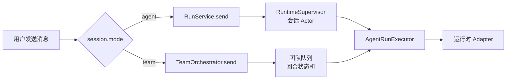
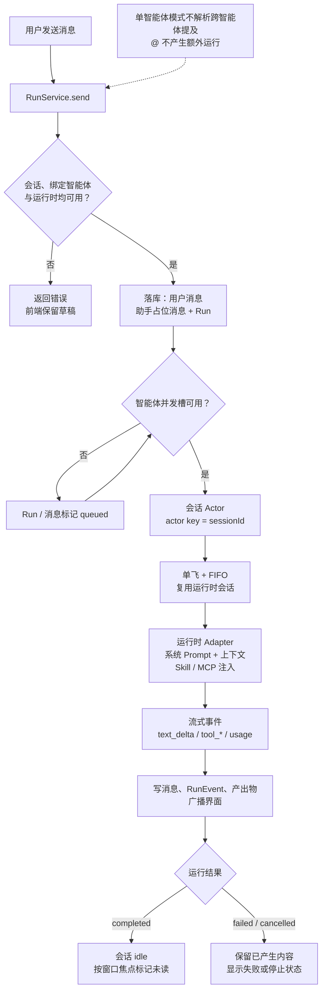
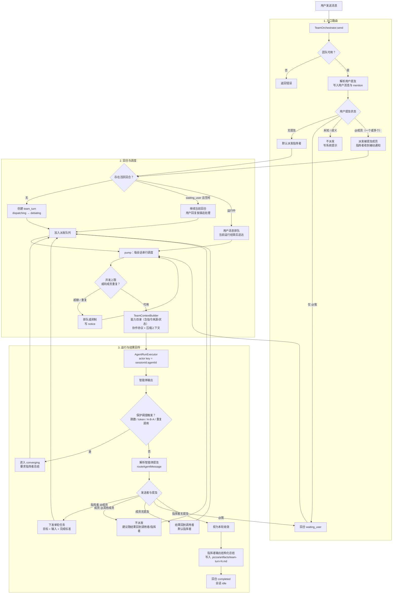

# 消息路由与处理流转

本文说明 Pizza 两种会话模式——**单智能体（单参与者）模式**与**智能体团队模式**——从用户发送消息到运行结束的路由决策和处理链路。产品规则以 `docs/PRD.md` §5.2 为准，团队协议细节见 `docs/TEAM-PROTOCOL.md`，实现位置见 `docs/IMPLEMENTATION.md` §5。

## 1. 入口分流

两种模式共用同一个消息入口，主进程读取会话模式后再交给不同的调度器；最终都通过同一个 `AgentRunExecutor` 调用运行时。

## 2. 单智能体模式

会话只绑定一个智能体，不存在跨智能体调度。用户消息默认发送给该智能体；消息中的 `@` 只作为内容保留，不会创建额外运行。同一会话的运行由会话 Actor 单飞并 FIFO 排队，智能体自己的并发上限在进入运行时调度器之前生效。

要点：

- 一条用户消息对应一次运行；运行中再次发送时进入会话队列，结束后按顺序处理。
- 停止只取消当前运行，已产生的文本保留，之后可以重新发送。
- 上下文由执行器组装；这里的 `@` 选择器只影响消息内容，不参与路由。
- 指令来源为 `leader` 的智能体在单智能体运行中没有指挥者下发角色指令，使用可选的单智能体兜底 Prompt；留空时使用通用兜底 Prompt。

## 3. 团队模式

团队会话绑定一个团队。用户未提及时默认路由给指挥者；用户和指挥者是唯一可以发起成员调度的人。指挥者 `@` 成员时，编排器下发一个单轮任务 Prompt（目标、输入、完成标准）；成员完成后把结果交回调用者或指挥者。成员之间的 `@` 不产生新的运行，只作为建议随结果回到指挥者。

要点：

- **调度权**：只有用户和指挥者能创建成员运行；成员消息中的 `@其他成员` 只作为建议，不直接触发调度。
- **单轮任务**：每次分派都要写清目标、输入和完成标准；成员只完成这一次任务并回传结果，不做跨成员直连。
- **结果回传**：成员无显式提及时回到调用者（默认指挥者）；指挥者无提及时视为收敛，输出结构化总结。
- **等待用户**：`@我` 使回合进入 `waiting_user`；用户回复继续当前回合，不新建回合。同一消息同时 `@成员` 和 `@我` 时，先完成成员运行，再进入等待。
- **队列**：同一会话同一时刻按团队并发上限调度；同一智能体最多一个运行；串行扇出时后一个成员能看到前一个结果。
- **保护**：跳数、token 预算、A→B→A、重复调用和超时只用于防止失控；达到阈值时进入 `converging`，由指挥者总结，不按固定轮次推进。

### 3.1 指令来源

每名成员按 `agent.instruction_mode` 选择 Prompt 来源：

- `self`（自带初始 Prompt）：使用成员自己的 Prompt 与团队覆盖，指挥者只描述任务。
- `leader`（指挥者动态下发）：不使用成员 Prompt 与团队覆盖；触发这次运行的消息（通常是指挥者的分派消息）作为本轮角色指令，追加到用户 Prompt；系统 Prompt 只说明“角色由调用者动态下发”。
- 指挥者上下文的能力目录会标注每名成员的指令来源。对 `leader` 成员，指挥者 `@` 时必须写清角色、边界、输出格式与完成标准。
- 指挥者自身始终使用自己的 Prompt；用户直接 `@` 模式二成员时，用户消息作为本轮角色指令。
- 单智能体运行、连接测试等没有指挥者下发的场景使用可选的单智能体兜底 Prompt；留空时使用通用兜底 Prompt。

## 4. 两种模式对照

| 维度 | 单智能体（单参与者）模式 | 团队模式 |
| --- | --- | --- |
| 会话绑定 | 一个智能体 | 一个团队（指挥者 + 成员） |
| 默认路由 | 绑定智能体 | 指挥者 |
| 提及的作用 | 仅作为消息内容 | 用户/指挥者 `@` 成员触发单轮任务；成员 `@` 成员只作为建议 |
| 指令来源 | 绑定智能体的 Prompt | 成员可选自带 Prompt 或指挥者动态下发 |
| 一条用户消息的运行数 | 1（运行中则排队） | 0 到多个，由派发目标决定 |
| 调度器 | 会话 Actor（单飞 + FIFO） | 每会话团队队列 + 团队/全局并发上限 |
| 结果去向 | 当前会话 | 调用者/指挥者；指挥者无提及则收敛为产出物 |
| 回合状态 | `message` / `run` | `team_turn` / `team_turn_event` |
| 结束条件 | 运行结束 | 指挥者停止派发并总结，或保护阈值触发收敛 |

## 5. 路由不变量

1. 单智能体模式不产生跨智能体调度，也不会因为 `@` 创建额外运行。
2. 团队中只有用户和指挥者能发起成员调度；成员之间的 `@` 不产生运行。
3. 同一智能体同一时刻最多一个运行；同一会话按队列和并发上限调度。
4. 指挥者不再提及成员时回合结束；跳数保护只防止 `@` 循环失控，不决定成员参与轮次。
5. 路由决策写入 `message_mention` 与 `team_turn_event`，供界面渲染、审计和崩溃恢复复用。
6. 模式二成员不使用自带 Prompt；本轮角色指令必须来自触发消息，且指挥者负责提供完整角色约束。
