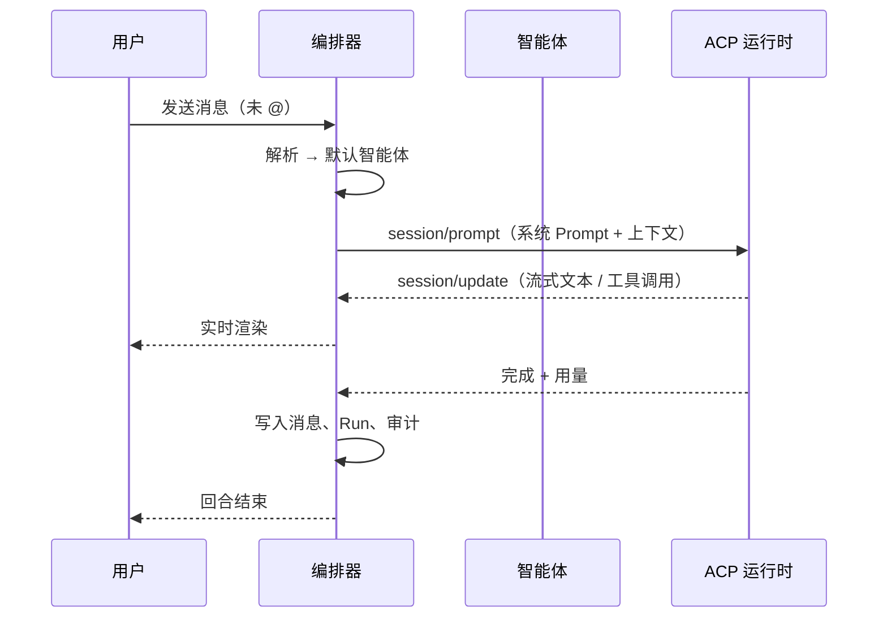
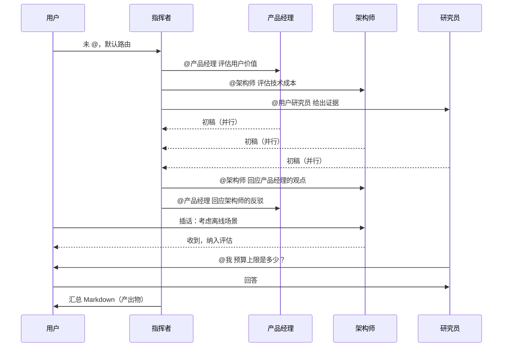
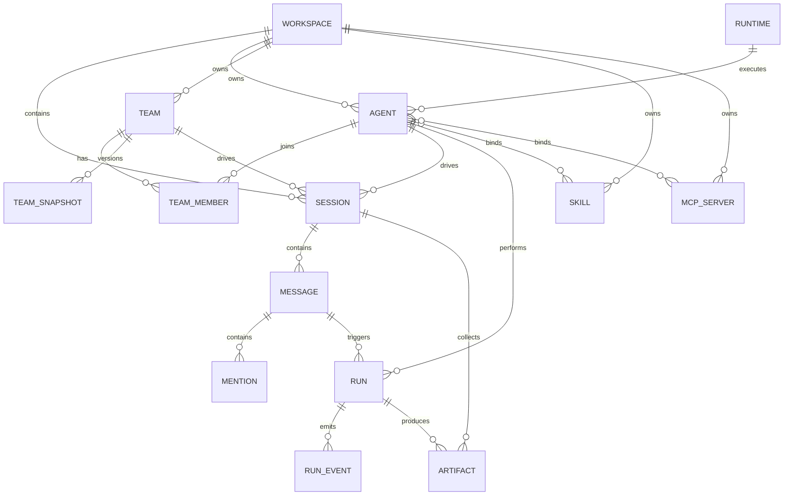
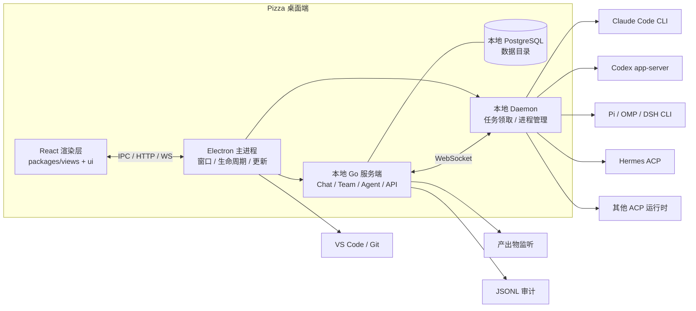

# Pizza 产品需求文档（PRD）

| 项目 | 内容 |
| --- | --- |
| 产品名称 | Pizza |
| 文档版本 | v0.1 |
| 日期 | 2026-11-03 |
| 状态 | 评审中 |
| 关联文档 | `docs/UI-SPEC.md`、`docs/ARCHITECTURE.md`、`docs/DECISIONS.md`、`docs/RESEARCH-UPSTREAM.md` |

---

## 0. 阅读说明

- **优先级**：`P0` = 首个可发布版本必须完成；`P1` = 紧随 P0 的增强；`P2` = 后续规划。用户原始清单中标注 P1 的条目，本文一律保留为 P1。
- **需求编号**：`SESS` 会话、`CHAT` 对话、`AGT` 智能体、`TEAM` 团队、`ACP` 运行时、`SKL` Skill、`MCP` MCP、`ART` 产出物、`SET` 设置、`NFR` 非功能。编号稳定，便于排期与验收。
- **验收标准**：每条 P0 需求都必须有可操作的验收条件；无法验收的描述不进入 P0。
- **范围基线**：P0 先打通「接入运行时 → 创建智能体 → 单智能体对话 → 创建团队 → 指挥者 @ 成员协作 → 产出物」这一条完整链路。

---

## 1. 产品定位

### 1.1 一句话

**Pizza 是一个以 `@` 为协作原语的多智能体工作台：把问题像披萨一样切开，@ 给合适的智能体或队友，各自完成一份，再由指挥者拼回完整答案。**

### 1.2 要解决的问题

| 现状 | 问题 |
| --- | --- |
| 每个 AI 工具一个窗口 | 上下文散落在不同会话，换一个智能体就要重新解释 |
| 单智能体只能串行 | 复杂问题没有分工、辩论、交叉验证，质量依赖单次回答 |
| 多智能体框架偏工程化 | 需要写代码编排，普通用户无法「像拉群一样」组队 |
| 运行时被厂商锁定 | Claude Code、Codex、Pi、Hermes 等各有一套入口，配置无法复用 |
| 协作过程不可见 | 谁做了什么、为什么这样决定、花了多少 token，事后无法回放 |

### 1.3 解决方案

1. **会话即工作区**：所有工作从一次对话开始，用户选择「一个智能体」或「一个智能体团队」。
2. **`@` 即调度**：用户 @ 智能体；指挥者 @ 成员；成员之间互相 @；智能体也可以 @ 用户提问。
3. **运行时通过 ACP 接入**：Pizza 不自带模型，而是驱动本机已安装、已登录的智能体 CLI。
4. **一切可配置**：智能体的 Prompt、Skill、MCP、运行时、思考强度、上下文压缩阈值都可配置；团队可覆盖成员配置并保存快照。
5. **人始终在环**：用户可随时插话、打断、停止；智能体需要拍板时主动 @ 用户。

### 1.4 目标用户

- 独立开发者、产品经理、设计师：一个人带一支智能体团队完成开发、调研、写作。
- 2–10 人小团队：共享智能体与团队配置，把重复工作流沉淀为团队模板。
- 研究与分析场景：需要多角色辩论、交叉验证、最终汇总为文档的任务。

### 1.5 典型场景

| 场景 | 参与方式 | 期望结果 |
| --- | --- | --- |
| 日常问答 / 编码 | 单智能体模式 | 像使用 Claude Code、Pi 一样完成一次任务 |
| 头脑风暴 | 团队模式，指挥者 + 多角色 | 多轮发散、辩论、收敛，输出 Markdown 方案 |
| 前后端协作 | 团队模式，指挥者 + 前端 + 后端 + 评审 | 并行产出代码与接口文档，评审后汇总 |
| 方案评审 | 团队模式，评审团 | 多视角挑错，指挥者输出结论与待办 |

### 1.6 产品边界（v1 不做）

- 不自带、不代理模型；模型能力完全来自用户接入的运行时。
- 不做公开 SaaS 多租户；P0 以本地单用户、单工作区为主。
- 不做 Issue / 看板 / 项目管理；Pizza 的协作载体是会话，不是任务单。
- 不做自动合并代码、自动发布；代码变更交由用户与 Git 工具确认。
- 不做移动端；桌面端优先（macOS 首发，Windows/Linux 随后）。

---

## 2. 设计原则

1. **对话是唯一入口**：创建、配置、执行、验收都围绕会话展开，不要求用户理解底层编排。
2. **`@` 是唯一调度语法**：所有跨智能体的任务分派都必须显式 @，可追踪、可审计、可打断。
3. **配置即数据**：智能体、团队、运行时、Skill、MCP 都是可导出、可快照、可复用的结构化数据。
4. **运行时无关**：通过 ACP 适配不同 CLI；新增运行时不应改动编排核心。
5. **人始终在环**：用户可随时插话、停止、审批；智能体不得在关键决策上自行放行。
6. **本地优先**：代码、密钥、会话与审计日志默认留在本机。
7. **一切可回放**：每条消息、每次运行、每个工具调用都有时间戳与归属。

---

## 3. 术语与核心概念

| 术语 | 英文 | 定义 |
| --- | --- | --- |
| 智能体 | Agent | 一个可被 @ 的 AI 角色，绑定运行时与配置，拥有名称、描述、头像 |
| 指挥者 | Commander / Leader | 团队模式中默认被 @ 的智能体，负责拆解任务、分派成员、汇总结果 |
| 成员 | Member | 团队中的其他智能体，可被指挥者或用户 @ |
| 团队 | Team | 一组智能体 + 一个指挥者 + 团队级配置 |
| 会话 | Session | 一次持续的工作上下文；绑定一个智能体或一个团队 |
| 消息 | Message | 会话中的一条内容，来源可以是用户、智能体或系统 |
| 提及 | Mention | 消息中的 `@名称`，是编排器分派任务的信号 |
| 回合 | Round | 从用户发出消息，到所有智能体停止或需要用户介入的一段过程 |
| 运行 | Run | 某个智能体针对某条消息的一次执行，包含流式输出、工具调用与用量 |
| 运行时 | Runtime | 实际执行智能体任务的 CLI / ACP 服务，例如 Claude Code、Codex |
| ACP | Agent Client Protocol | 客户端与智能体运行时之间的标准协议，支持会话、流式消息、工具调用与权限请求 |
| 指令来源模式 | Instruction Source | 成员 Prompt 的来源：自带初始 Prompt，或由指挥者动态下发角色指令 |
| Skill | Skill | 可复用的能力包（`SKILL.md` + 资源），可挂载到智能体或团队成员 |
| MCP | Model Context Protocol | 工具/资源接入协议，智能体可通过 MCP Server 获得外部能力 |
| 产出物 | Artifact | 会话中产生的文档、代码、报告等可打开、可下载的文件 |
| 快照 | Snapshot | 团队配置在某一时刻的完整副本，可用于复用、回滚或复制新团队 |
| 工作区 | Workspace | 本机上的一个代码/文档目录，会话与产出物默认落在这里 |

### 3.1 两种会话模式

- **智能体模式（Agent Mode）**：会话绑定一个智能体。用户的消息默认路由给它；它也可以 @ 自己？不——单智能体模式下不存在跨智能体 @，@ 只用于 @用户。
- **智能体团队模式（Team Mode）**：会话绑定一个团队。用户未 @ 时默认路由给指挥者；指挥者通过 @成员 分派；成员之间可以互相 @；任何人可以 @用户 请求拍板。

> **约定**：P0 不支持在会话中途切换模式；需要换模式时新建会话。P1 支持「复制为另一种模式的新会话」。

### 3.2 指令来源模式

| 模式 | 说明 | 适用 | 优先级 |
| --- | --- | --- | --- |
| 模式一：自带初始 Prompt | 成员使用自己保存的 Prompt 与配置，指挥者只描述任务 | 通用团队、长期角色 | **P0 默认** |
| 模式二：指挥者动态下发 | 成员不预设角色 Prompt，每次由指挥者下发完整角色指令与约束 | 临时团队、指挥者强控制 | P1 |

> 用户备注「智能体的 mode 可以放在 P1，P0 为智能体的默认模式」按此落地：P0 只使用模式一；模式二及每个智能体的默认模式选择器放在 P1。该理解列入开放问题，评审时确认。

---

## 4. 角色与权限

P0 为本地单用户产品，权限模型保持简单，但为未来多人协作预留边界。

| 能力 | 用户 | 指挥者 | 成员 | 系统编排器 |
| --- | --- | --- | --- | --- |
| 新建/删除会话 | ✅ | — | — | — |
| @ 任意智能体 | ✅ | ✅（仅本团队成员） | ✅（仅本团队成员） | — |
| @ 用户 | — | ✅ | ✅ | ✅（系统通知） |
| 停止运行 | ✅（全部/单个） | ✅（成员） | ✅（自己） | ✅（超时/超预算） |
| 修改智能体/团队配置 | ✅ | — | — | — |
| 审批工具调用 | ✅ | — | — | — |
| 写入产出物 | — | ✅ | ✅ | — |
| 查看审计日志 | ✅ | — | — | — |

---

## 5. 核心机制：@ 协作协议

这是 Pizza 与普通聊天产品最本质的差异，也是实现与测试的重点。

### 5.1 寻址语法

- 用户在输入框中输入 `@` 弹出选择器，按分组展示：**指挥者**、**团队成员**、**我**。
- 选择后插入可识别的 mention chip，序列化保存为 `{agent_id, name, offset}`。
- 智能体输出中的 `@名称` 由编排器解析；解析顺序：本会话精确名称 → 本团队内名称 → 全局唯一名称。重名时拒绝猜测，转为系统提示「提及不明确」并要求发送者使用 `@名称#短ID`（P1）。
- 保留提及：`@我` / `@user` 指向人类用户；`@全体`（P1）向团队所有成员扇出。
- 未知 `@` 不触发调度，原样保留为文本，并在消息旁显示「未找到该智能体」。

### 5.2 路由规则

| # | 来源 | 会话模式 | 消息中的 @ | 路由结果 | 上下文 |
| --- | --- | --- | --- | --- | --- |
| R1 | 用户 | 单智能体 | 无 | 默认智能体 | 最近对话 + 用户消息 |
| R2 | 用户 | 团队 | 无 | 指挥者 | 最近对话 + 用户消息 + 团队名单 |
| R3 | 用户 | 任意 | `@某成员` | 该成员 | 用户消息 + 被提及前的最近上下文；指挥者收到被动通知 |
| R4 | 用户 | 任意 | 多个 @ | 依次/并发调度每个目标 | 同上；并发数受上限约束 |
| R5 | 智能体 | 团队 | `@某成员` | 该成员，调用者为当前智能体 | 触发消息 + 当前智能体的任务说明 + 共享上下文 |
| R6 | 智能体 | 团队 | 多个 @ | 扇出；默认并发，可配置串行 | 同上 |
| R7 | 智能体 | 任意 | `@我` | 暂停链条，通知用户，等待回复 | 附带智能体的问题与当前进度 |
| R8 | 智能体 | 团队 | 无 @ | 回给调用者；若调用者是用户则结束本回合 | 智能体回复作为结果返回 |
| R9 | 智能体 | 单智能体 | 无 @ | 结束本回合，等待用户 | — |
| R10 | 用户 | 任意 | `@指挥者` | 指挥者重新接管，读取最新进展 | 最近上下文 + 未完成事项 |

**补充规则：**

- 指挥者被 @ 时，必须能看到自上次它发言以来的所有成员消息（系统会注入摘要 + 原文）。
- 成员被用户直接 @ 时，默认「抄送指挥者」：指挥者收到一条系统事件，但不自动运行；避免打断用户意图。
- 同一条消息中重复 @ 同一目标只调度一次。
- 智能体不能 @ 自己；自引用会被编排器忽略并记录审计事件。

### 5.3 上下文组装

每次运行（Run）注入以下内容，按优先级从高到低，超出预算时从低优先级开始压缩：

1. **系统约束**：Pizza 协作规则、安全边界、输出格式要求。
2. **当前任务**：触发它的消息、调用者的任务说明、期望产出。
3. **角色配置**：智能体有效 Prompt（含团队覆盖）、思考强度、工具约束。
4. **团队名单**：成员名称、描述、职责、当前状态（谁在运行）。
5. **会话上下文**：最近 N 条消息；更早的消息压缩为摘要。
6. **能力清单**：可用 Skill 的 `name + description`、可用 MCP 工具名。
7. **工作区信息**：根目录、关键文件列表（按需）、当前 Git 分支。
8. **记忆**：用户/工作区级长期记忆（P1）。

**压缩规则：**

- 每个智能体可配置「上下文压缩阈值」（如 200k tokens，按 100k 步长）与「保留最近消息数」。
- 达到阈值时，先生成结构化摘要（目标、决定、未决问题、产出物），再丢弃原始消息。
- 以下内容永不压缩：当前任务、未决问题、产出物路径、用户明确要求保留的内容。

### 5.4 调度与并发

- 每个会话维护一个调度队列；同一智能体同一时刻只处理一个 Run。
- 默认最大并发 Run 数：3（全局可配，默认值写入系统设置）。
- 扇出策略：
  - **并发**（默认）：多个成员同时开始，适合独立回答与评审。
  - **串行**：按 @ 顺序执行，后一个能看到前一个的结果，适合链式加工。
- 指挥者可显式声明策略：`@A @B 并行` / `@A @B 串行`（P1 解析自然语言；P0 使用团队配置的默认策略）。

### 5.5 插话、打断与停止

- 用户在任何时刻都可以发送消息，不受当前运行阻塞。
- 插话模式（会话级设置，默认「排队」）：
  - **排队**：消息进入队列，当前 Run 结束后立即处理。
  - **立即插话**：若运行时支持运行中追加输入（ACP `session/prompt` 或运行时 follow-up 能力），直接注入当前 Run；否则降级为排队，并在 UI 明确提示「已排队，当前运行结束后送达」。
- 用户可对单条运行点击「停止」，或点击「全部停止」终止本回合所有运行。
- 停止是协作语义：编排器会向被停止的智能体发送取消，并在会话中插入系统事件「用户停止了 @X 的运行」。
- P1：暂停/继续整个回合；P0 只提供停止 + 重试。

### 5.6 循环与成本保护

| 保护 | 默认值 | 行为 |
| --- | --- | --- |
| 单回合最大跳数 | 12 | 达到后停止调度，指挥者输出阶段性总结 |
| 辩论最大轮次 | 5 | 达到后强制进入收敛 |
| 单 Run 超时 | 30 分钟 | 取消运行并标记失败 |
| 单回合 token 预算 | 团队配置，默认不限 | 达到 80% 提醒，100% 停止 |
| 重复调用抑制 | 开启 | 同一发送者 → 同一目标、内容相似度极高且在 2 分钟内，不重复调度 |
| 无限互 @ 检测 | 开启 | A→B→A 连续 3 次且无新信息时，插入系统提示并要求指挥者收敛 |

### 5.7 状态模型

**消息状态**：`draft → queued → running → streaming → completed | failed | cancelled`

**运行状态**：`queued → starting → running → waiting_permission → completed | failed | cancelled | timeout`

**会话状态**：`idle | running | waiting_user | paused | error`

**团队回合状态**：`dispatching → debating → converging → completed`

UI 必须在消息与头像上如实反映状态，不得用「正在输入」掩盖失败或等待审批。

---

## 6. 功能需求

### 6.1 启动与新建会话

| 编号 | 需求 | 优先级 | 验收标准 |
| --- | --- | --- | --- |
| SESS-01 | 首次启动引导：检测本机已安装的运行时，展示可接入列表；无可用运行时时提供安装指引 | P0 | 首次启动 30 秒内给出检测结果；未检测到运行时也能进入应用并查看指引 |
| SESS-02 | 新建会话时通过「参与者」下拉选择智能体或智能体团队；支持搜索与最近使用 | P0 | 一次下拉完成选择；智能体与小隊分组展示；空列表有创建入口 |
| SESS-03 | 新建会话可指定工作区目录（默认上次使用目录） | P0 | 目录选择器可创建/选择文件夹；无权限时给出明确错误 |
| SESS-04 | 会话自动命名：取首条用户消息前 24 字；可手动重命名 | P0 | 新会话 1 秒内出现在历史列表；重命名即时生效 |
| SESS-05 | 会话绑定模式后不可中途切换；提供「复制为新会话」入口 | P1 | 复制后保留原会话，新模式可重新选择智能体/团队 |
| SESS-06 | 从模板创建会话（头脑风暴、代码评审等） | P1 | 模板预填团队与首条指令 |
| SESS-13 | 参与者选择器：分组展示「智能体」与「智能体团队」，选中项带勾选；选择智能体即进入单智能体模式，选择团队即进入团队模式 | P0 | 不出现独立的「智能体模式/团队模式」切换控件；选择后输入框路由提示同步更新 |
| SESS-14 | 多工作区并列：左侧栏展示全部工作区，当前工作区高亮；每个工作区直接列出其会话；没有工作区的会话归入默认工作区 | P0 | 不再提供独立的会话列表与日期分组；工作区数量增加时列表可滚动 |
| SESS-15 | 工作区快捷操作：每行提供「在 … 中新建任务」与「置顶 / 编辑 / 归档工作区」菜单 | P0 | 新建任务进入该工作区首页并聚焦输入框；置顶工作区进入侧栏顶部「置顶」分组；归档后自动切换到其他工作区 |
| SESS-16 | 工作区首页头部：显示名称、目录、活跃会话数与置顶按钮 | P0 | 活跃数按运行中/等待中的会话计算；置顶后工作区进入「置顶」分组 |
| SESS-17 | 会话操作菜单：会话行支持右键与悬停「⋯」打开同一菜单，包含重命名、分叉会话、导出会话、归档、永久删除 | P0 | 分叉复制当前会话到分叉点并切换到新会话；归档移出侧栏；永久删除需二次确认 |

### 6.2 对话主界面

| 编号 | 需求 | 优先级 | 验收标准 |
| --- | --- | --- | --- |
| CHAT-01 | 统一消息流：用户、智能体、系统事件按时间排列，系统事件样式弱化 | P0 | 三类消息视觉可区分；系统事件不抢占主视觉 |
| CHAT-02 | 智能体流式输出：逐字渲染，显示头像、名称、状态、耗时 | P0 | 首字延迟 ≤ 2s（取决于运行时）；断流有失败态与重试 |
| CHAT-03 | Markdown 渲染：标题、列表、表格、代码块、链接、任务列表；代码块可复制 | P0 | 复杂 Markdown 不破版；代码高亮正确 |
| CHAT-04 | 工具调用折叠展示：名称、参数摘要、状态、耗时；可展开查看输出 | P0 | 运行中可实时更新；失败工具红色标记并可查看错误 |
| CHAT-05 | @ 提及 chip：头像 + 名称 + 角色标识；点击查看智能体卡片 | P0 | chip 与纯文本可区分；删除 chip 后调度行为同步变化 |
| CHAT-06 | 多智能体身份区分：头像、名称、角色色；同一智能体消息连续时合并头部 | P0 | 5 个智能体同时发言仍可快速辨认 |
| CHAT-07 | 回合分隔：显示「第 N 轮」「@A、@B 正在处理」「等待 @用户 回复」 | P0 | 长会话中可快速定位回合边界 |
| CHAT-08 | 用户可随时插话；输入框在运行中仍可用 | P0 | 运行中发送不阻塞；排队/插话状态明确 |
| CHAT-09 | 停止单个运行与全部运行 | P0 | 点击后 2 秒内状态变为已停止；已产出内容保留 |
| CHAT-10 | 消息操作：复制、引用、重试、删除；智能体消息支持「继续」 | P0 | 操作有确认或可撤销；重试不会重复计入原消息 |
| CHAT-11 | 附件：图片、文本、代码文件；拖拽与粘贴 | P0 | 单文件 ≤ 20MB；附件在消息内可预览/下载 |
| CHAT-12 | 会话内搜索与跳转 | P1 | 命中高亮；可上下跳转 |
| CHAT-13 | 导出会话为 Markdown / JSONL | P1 | 导出内容包含消息、@ 关系、运行耗时与用量 |
| CHAT-14 | 折叠「思考过程」（运行时提供时） | P1 | 默认折叠，展开不影响布局 |
| CHAT-15 | 命令面板与快捷键（发送、停止、新会话、切换智能体） | P1 | 常用操作可全键盘完成 |
| CHAT-16 | 输入框「+」菜单：添加文件/图片、引用 Skill、引用 MCP 工具、打开工作区文件夹、引用会话/产出物 | P0 | 菜单分组展示；文件 ≤ 20MB；引用项以 chip 形式出现在输入框上方 |
| CHAT-17 | 输入 `/` 打开 Skill 与命令选择器；选中后插入 `/skill-name` chip | P0 | 支持搜索、键盘上下选择、Esc 关闭；只列出已挂载且启用的 Skill |
| CHAT-18 | 消息级能力引用：本次消息引用的 Skill/MCP 只对本次 Run 生效，不修改智能体配置 | P0 | 消息中可见引用 chip；运行结束不残留；审计记录引用清单 |
| CHAT-19 | 输入框上方展示本次待发送的附件与引用清单，可单独移除 | P0 | 移除后发送内容同步变化 |
| CHAT-20 | 命令面板：点击头部搜索或 ⌘K 打开；分组展示「新建」与「最近」，可搜索会话、智能体、团队与命令 | P0 | 支持 ↑↓、Enter、Esc；执行后面板关闭并跳转；背景模糊，面板居中 |

### 6.3 智能体管理

#### 6.3.1 列表与生命周期

| 编号 | 需求 | 优先级 | 验收标准 |
| --- | --- | --- | --- |
| AGT-01 | 智能体列表：头像、名称、描述、运行时、在线状态、最近使用 | P0 | 20 个智能体下滚动流畅；支持搜索 |
| AGT-02 | 新建 / 编辑 / 复制 / 归档 / 删除 | P0 | 删除前二次确认；被团队或会话引用时提示影响范围 |
| AGT-03 | 新建后默认生成头像；支持上传或从预设中选择 | P0 | 头像生成确定性（同一 ID 稳定）；上传裁剪为方形，≤ 2MB |
| AGT-04 | 必填校验：名称唯一、运行时可用、Prompt 非空（模式一） | P0 | 校验失败定位到字段并说明原因 |

#### 6.3.2 配置项

| 编号 | 配置 | 说明 | 优先级 | 默认值 |
| --- | --- | --- | --- | --- |
| AGT-05 | 名称 | 会话内唯一；重名自动追加序号 | P0 | — |
| AGT-06 | 描述 | 一句话职责，用于指挥者选择成员与 @ 选择器 | P0 | 空 |
| AGT-07 | 头像 | 自动生成 / 上传 / 预设 | P0 | 自动生成 |
| AGT-08 | 运行时绑定 | 选择已注册运行时；显示状态与能力 | P0 | 系统默认运行时 |
| AGT-09 | 初始 Prompt | 角色、职责、输出格式、边界；支持变量 | P0 | 内置「通用助手」模板 |
| AGT-10 | 指令来源模式 | 自带 Prompt / 指挥者动态下发 | P1（P0 固定模式一） | 自带 Prompt |
| AGT-11 | Skill 绑定 | 多选；显示将注入的能力清单 | P0 | 空 |
| AGT-12 | MCP 绑定 | 多选 Server；可限制可用工具 | P0 | 空 |
| AGT-13 | 思考强度 | minimal / low / medium / high / max；映射到运行时能力 | P0 | medium |
| AGT-14 | 上下文压缩阈值 | token 数或百分比；达到后摘要压缩；滑块步长 100k | P0 | 100k / 200k，或运行时的 70% |
| AGT-15 | 模型 | 运行时可用模型列表；可留空使用默认 | P1 | 运行时默认 |
| AGT-16 | 单次输出上限 | max tokens | P1 | 运行时默认 |
| AGT-17 | 权限与审批 | 工作区路径、工具允许/拒绝、审批策略 | P0 | 工作区内 + 危险操作需审批 |
| AGT-18 | 智能体默认模式 | 默认以智能体模式或团队模式出现 | P1 | 智能体模式 |
| AGT-19 | 测试智能体 | 侧栏发送测试消息，展示运行时、耗时与错误 | P0 | 测试不写入正式会话 |
| AGT-20 | 并发上限 | 同一智能体同时运行的任务数；超出排队 | P0 | 3（范围 1–10） |
| AGT-21 | 对话开场白 | 最多 3 条「标签 + 指令」，选中后填入输入框而不直接发送 | P1 | 空 |
| AGT-22 | 自定义环境变量 / 参数 | 启动运行时注入；参数逐项追加、不做 shell 展开；敏感值走钥匙串 | P1 | 空 |
| AGT-23 | 服务等级 | 仅部分运行时支持（如 Codex 的快速档） | P2 | 运行时默认 |
| AGT-24 | AI 创建智能体 | 通过对话生成草稿，用户确认后保存 | P1 | — |
| AGT-25 | 调用权限 | 仅我 / 工作区 / 指定成员（本地单用户 P0 固定「仅我」） | P2 | 仅我 |

**Prompt 变量**：`{{agent.name}}`、`{{team.name}}`、`{{team.roster}}`、`{{session.goal}}`、`{{workspace.path}}`、`{{round}}`、`{{artifacts}}`。变量在运行时替换，未定义变量保持原样并记录警告。

**配置解析优先级**（从高到低）：会话临时覆盖（P1）→ 团队内成员覆盖 → 智能体自身配置 → 系统默认。

### 6.4 运行时与 ACP 接入

| 编号 | 需求 | 优先级 | 验收标准 |
| --- | --- | --- | --- |
| ACP-01 | 运行时列表：名称、类型、状态、能力、最近连接时间、被引用次数 | P0 | 断线状态可见；可一键重连 |
| ACP-02 | 新增运行时表单：名称、适配器、传输方式（stdio / WebSocket / HTTP）、命令与参数、环境变量、连接地址、初始测试命令、超时、自动重连 | P0 | 必填项校验；环境变量值可隐藏 |
| ACP-03 | 连通性测试：点击后展示分步结果（启动 → initialize → 创建临时会话 → 测试消息 → 清理） | P0 | 成功展示协议版本、能力、可用模型、往返延迟；失败展示具体步骤、退出码与 stderr 末尾 20 行 |
| ACP-04 | 测试成功后才允许「注册」；注册后出现在运行时列表并可被智能体绑定 | P0 | 未通过测试无法保存为可用运行时 |
| ACP-05 | 支持适配器：Claude Code、Codex、Pi、Oh My Pi、DeepSeek Harness、Hermes、通用 ACP | P0 | 每个适配器有默认命令模板；缺 CLI 时给出安装指引 |
| ACP-06 | 运行时能力探测：模型列表、是否支持运行中追加、是否支持 MCP、是否支持 Skill、是否支持思考强度 | P0 | 能力写入运行时记录；不支持的配置在 UI 中禁用并解释 |
| ACP-07 | 运行时级并发与超时配置 | P1 | 超时生效；并发超限时排队 |
| ACP-08 | 运行时日志：连接、会话创建、错误；可导出 | P1 | 日志脱敏，不含 token |
| ACP-09 | 运行时健康检查与自动重连 | P0 | 断线 5 秒内标记离线；重连后恢复可调度 |
| ACP-10 | 通用 ACP 自定义传输（URL + Header / 命令 + 参数） | P1 | 可接入未内置的 ACP 实现 |

**目标运行时的真实协议（依据参考项目源码调研，详见 `docs/RESEARCH-UPSTREAM.md`）：**

| 运行时 | 原生协议 | Pizza 接入方式 | 说明 |
| --- | --- | --- | --- |
| Claude Code | CLI `stream-json` | CLI 适配；可选 ACP 包装 | 参考项目以 `claude --output-format stream-json` 驱动；ACP 需第三方适配器 |
| Codex | `codex app-server` JSON-RPC | CLI 适配；可选 ACP 包装 | 复用参考项目的 Codex backend |
| Pi | CLI（会话文件） | CLI 适配 | 复用 `pi` backend；支持 Skill/MCP |
| Oh My Pi | CLI（`omp`，Pi 协议族） | CLI 适配 | 参考项目将 `omp` 映射到 pi 协议族 |
| DeepSeek Harness | CLI（`dsh`） | CLI 适配 | 复用 `dsh` backend |
| Hermes | **原生 ACP** | ACP 直连 | 复用参考项目的 JSON-RPC stdio 客户端 |
| 其他 ACP 运行时 | ACP | ACP 直连 | Kimi、Kiro、Grok、Qoder、Trae、QwenPaw 等 |
| 通用 | ACP / CLI | 用户填写 | 必须能完成握手与测试消息 |

> **产品表述**：Pizza 的运行时层是「**统一适配层，ACP 优先，CLI 兼容**」。不应向用户宣称所有运行时都通过 ACP 通信；UI 在运行时详情中明确标注「ACP」或「CLI 兼容」。上表命令与能力需在 P0 实现时逐个跑通并回填 `docs/RESEARCH-UPSTREAM.md`。

### 6.5 团队管理

| 编号 | 需求 | 优先级 | 验收标准 |
| --- | --- | --- | --- |
| TEAM-01 | 团队列表：团队头像、名称、描述、成员数、指挥者、最近使用 | P0 | 支持搜索与按最近使用排序 |
| TEAM-02 | 新建 / 编辑 / 复制 / 归档 / 删除团队 | P0 | 删除前提示受影响的会话与快照 |
| TEAM-03 | 团队头像：默认生成（成员头像拼贴）、上传、预设 | P0 | 成员变化后自动头像可刷新 |
| TEAM-04 | 指定指挥者，且指挥者必须是成员 | P0 | 未指定指挥者不能保存；更换指挥者即时生效 |
| TEAM-05 | 从智能体库添加成员；支持搜索、多选、排序 | P0 | 添加后立即出现在成员列表；重复添加被阻止 |
| TEAM-06 | 在团队内直接新建成员，与全局智能体列表无关 | P0 | 内联成员不污染全局列表；删除团队时按规则处理 |
| TEAM-07 | 移除成员；被移除成员的团队内覆盖配置一并删除 | P0 | 至少保留指挥者；移除前二次确认 |
| TEAM-08 | 团队成员级覆盖：替换/追加 Prompt、增删 Skill、增删 MCP | P0 | 覆盖项在成员卡片上可见；可一键恢复继承 |
| TEAM-09 | 团队级编排 Prompt：指挥者如何使用团队、轮次策略、收敛条件 | P0 | 与指挥者自身 Prompt 分离；保存前可预览最终生效 Prompt |
| TEAM-10 | 团队配置保存为快照；从快照恢复或复制为新团队 | P1 | 快照记录创建时间、成员快照与覆盖项；恢复前提示覆盖 |
| TEAM-11 | 团队模板：头脑风暴队、前后端开发队、评审队 | P1 | 一键创建，成员与 Prompt 预填 |
| TEAM-12 | 团队有效性校验：名称唯一、成员非空、指挥者在列、无循环引用 | P0 | 保存失败时定位到具体成员 |
| TEAM-13 | 成员角色描述：一句话说明该成员适合接什么活，注入指挥者上下文 | P0 | 角色描述进入指挥者可见的团队名单，但不改变权限 |
| TEAM-14 | 指挥者协议：只协调、不代替成员实现；分派后停止等待；每轮记录评估结果 | P0 | 内置协议不可被成员覆盖；可在团队 Prompt 中追加约束 |
| TEAM-15 | 精确提及语法：指挥者使用 `[@名称](mention://agent/<id>)` 分派；纯文本 `@名称` 不触发 | P0 | 系统自动生成可用语法；解析失败给出明确提示 |
| TEAM-16 | 再触发规则：成员回复后唤醒指挥者；显式 @ 其他目标时不唤醒；指挥者自己发言不触发自己 | P0 | 与参考项目的 Squad 再触发规则一致；防重复入队 |
| TEAM-17 | 指挥者不得自行合并/关闭工作；收敛后输出总结并等待用户验收 | P0 | 审计记录每轮评估；用户可要求继续辩论 |

**内联成员的生命周期**：属于团队私有；可「提升为全局智能体」；团队删除时默认保留为归档的全局智能体（可配置为删除），避免误删用户资产。

### 6.6 Skill 管理

| 编号 | 需求 | 优先级 | 验收标准 |
| --- | --- | --- | --- |
| SKL-01 | Skill 列表：名称、描述、版本、来源、被引用次数、启用状态 | P0 | 支持搜索与标签筛选 |
| SKL-02 | 新建 Skill（`SKILL.md` + 资源文件） | P0 | 保存前校验 frontmatter 必填字段 |
| SKL-03 | 从本地文件夹 / ZIP / Git 仓库导入 | P0 | 导入前预览文件清单与冲突；支持覆盖/保留两份 |
| SKL-04 | 编辑与删除；删除前列出受影响的智能体与团队 | P0 | 被引用时要求确认；提供解绑选项 |
| SKL-05 | 挂载到智能体或团队成员；显示最终生效清单 | P0 | 团队覆盖可增删；冲突时以团队为准 |
| SKL-06 | 运行时注入：将生效 Skill 物化到运行目录，并把清单写入上下文 | P0 | 运行时能读取到 `SKILL.md`；失败时给出可诊断错误 |
| SKL-07 | Skill 版本与更新检测（Git 来源） | P1 | 可查看差异并更新 |
| SKL-08 | Skill 市场 / 导入链接 | P2 | — |
| SKL-09 | 从已连接运行时扫描并导入本地 Skill（快照，不自动同步） | P1 | 导入前预览；冲突可选保留两份/覆盖/跳过 |
| SKL-10 | 同名冲突处理：停止（默认）/ 覆盖 / 重命名 / 跳过 | P0 | 覆盖保留 ID 与已有绑定；操作入审计 |
| SKL-11 | 内置 Skill：Pizza 协作协议说明（@ 语法、团队角色、产出规范） | P0 | 所有智能体默认获得且不可删除；可禁用单次注入 |

### 6.7 MCP 管理

| 编号 | 需求 | 优先级 | 验收标准 |
| --- | --- | --- | --- |
| MCP-01 | MCP Server 列表：名称、传输方式、状态、工具数、被引用次数 | P0 | 支持启用/禁用、搜索 |
| MCP-02 | 新增 stdio Server：命令、参数、环境变量、工作目录 | P0 | 环境变量值加密存储；支持引用系统环境变量 |
| MCP-03 | 新增 SSE / HTTP Server：URL、Header、超时 | P0 | Header 中的密钥掩码显示 |
| MCP-04 | 连接测试与工具发现 | P0 | 展示工具名、描述、参数 schema；失败展示错误 |
| MCP-05 | 挂载到智能体或团队成员；按工具配置允许/拒绝 | P0 | 最终工具清单可预览 |
| MCP-06 | 运行时注入：转换为 ACP `mcpServers` 或运行时原生配置 | P0 | 工具调用在会话中可见并可审批 |
| MCP-07 | 健康检查与自动重连 | P1 | 工具不可用时在 UI 标注 |
| MCP-08 | MCP 工具调用审批策略（总是允许 / 每次询问 / 禁止） | P0 | 危险工具默认每次询问 |
| MCP-09 | 三层配置合并：智能体自有 > 工作区库绑定 > 运行时本地配置；被覆盖项标注 | P0 | 合并结果可在智能体页预览；冲突有解释 |
| MCP-10 | 配置只写：保存后不回显 URL/Header/环境变量；修改需整体替换 | P0 | 仅能通过「替换配置」修改；读取/修改入审计 |

### 6.8 工作区与历史会话

| 编号 | 需求 | 优先级 | 验收标准 |
| --- | --- | --- | --- |
| SESS-07 | 左侧会话列表：按工作区归组，支持按智能体/团队筛选 | P0 | 1000 个会话下滚动与搜索流畅 |
| SESS-08 | 会话搜索：标题、消息内容、智能体名 | P0 | 结果高亮并跳转到命中消息 |
| SESS-09 | 会话菜单：重命名、分叉、归档、永久删除 | P0 | 分叉复制当前会话并切换；归档进入「已归档会话」；永久删除二次确认后不可恢复 |
| SESS-10 | 会话显示未读/运行中状态 | P0 | 后台运行完成有标记 |
| SESS-11 | 工作区切换：点击工作区打开系统文件夹选择器；选中已有目录则切换，新目录则创建工作区 | P0 | 切换后新会话与后续运行使用该目录 |
| SESS-12 | 会话导出与导入 | P1 | JSONL 可完整还原消息与运行元数据 |

### 6.9 右侧功能栏

| 编号 | 需求 | 优先级 | 验收标准 |
| --- | --- | --- | --- |
| ART-01 | 产出物文件树：按目录结构展示文件夹与文件，支持展开/收起、筛选、修改状态（M/A/info） | P0 | 新产出物实时出现；筛选命中文件；文件夹状态持久化到会话 |
| ART-02 | 产出物预览：Markdown、代码、图片、PDF（P1） | P0 | Markdown 渲染与下载正常 |
| ART-03 | 打开所在目录 / 用默认应用打开 / 下载 | P0 | 路径不存在时给出提示 |
| ART-04 | 会话头部一键用首选编辑器打开当前工作区 | P0 | 支持访达、Cursor、VS Code、Zed、IntelliJ IDEA、终端、Warp；缺失时提供安装指引与复制路径 |
| ART-09 | 编辑器选择器：会话头部提供「编辑器图标 + 下拉」，当前项带勾选；选择后成为首选编辑器 | P0 | 选择立即生效并持久化；右侧产出物面板不再重复放置打开按钮 |
| ART-10 | 「对话轨迹」页签：展示本回合参与者状态、关键调度/辩论/插话/收敛事件 | P0 | 与会话同步更新；收敛后显示完成状态；切换到其他页签不丢状态 |
| ART-11 | 每位参与者的 token 统计：输入、输出、合计与费用；底部汇总 | P1 | 数据来自运行用量；未知模型标注；支持按会话/智能体查看 |
| ART-05 | 变更记录：按运行列出文件新增/修改/删除 | P1 | 可打开 diff |
| ART-06 | Git 面板：worktree、状态、暂存、提交、历史 | P1 | 不破坏用户已有 Git 状态；危险操作二次确认 |
| ART-07 | JSONL 审计日志查看器：按会话/运行/智能体筛选 | P1 | 支持下载原始 JSONL；敏感字段脱敏 |
| ART-08 | 产出物固定/收藏 | P1 | 固定在会话顶部 |

### 6.10 设置

| 编号 | 需求 | 优先级 | 验收标准 |
| --- | --- | --- | --- |
| SET-01 | 设置导航：个人（个人资料、语言与外观）、数据（记忆管理、已归档会话）、团队（智能体、智能体团队、Skills、MCP、运行时、统计）、系统（系统设置、关于 Pizza 最后） | P0 | 团队管理与配置全部内嵌设置；所有入口可达；当前页高亮 |
| SET-02 | 记忆管理：查看、编辑、删除、导出长期记忆；区分用户级/工作区级 | P1 | 修改后新会话生效；可一键清空 |
| SET-03 | 语言：简体中文 / English | P0 | 切换后无需重启；日期/数字格式跟随 |
| SET-04 | 外观：浅色 / 深色 / 跟随系统；字号；密度；减少动效 | P0 | 即时生效并持久化 |
| SET-05 | 系统：默认工作区（默认 `~/Pizza`）、默认运行时（默认 Pi）、最大并发、数据目录（默认 `~/.pizza`）、日志级别、自动更新、匿名统计开关 | P0 | 修改有说明；需重启的项明确标注 |
| SET-06 | 已归档会话：恢复、永久删除、批量清理 | P0 | 永久删除二次确认 |
| SET-07 | 关于 Pizza：版本、构建号、开源协议、第三方归属、反馈入口 | P0 | 链接可打开；归属信息完整 |
| SET-08 | 统计：按今天/近 7 天/近 30 天展示 token、费用、运行次数、成功率；可按智能体/团队/模型拆分 | P1 | 时间过滤即时生效；图表可交互；支持导出 CSV |
| SET-09 | 数据备份与恢复（导出全部配置与会话） | P1 | 导入前校验版本；失败不破坏现有数据 |
| SET-10 | 检查更新与更新通道 | P1 | 下载进度可见；失败可重试 |
| SET-11 | 账户菜单：点击左下角头像打开；包含个人资料、主题、语言、快捷键、文档、更新日志、Discord、退出登录 | P0 | 主题/语言为二级菜单；当前项带勾选；本地模式退出登录给出说明 |
| SET-12 | 帮助菜单：点击左下角「?」打开；包含文档、更新日志、Discord、反馈 | P0 | 外链带 ↗；反馈打开应用内表单；菜单锚定在按钮上方 |

### 6.11 通知与审批

| 编号 | 需求 | 优先级 | 验收标准 |
| --- | --- | --- | --- |
| NTF-01 | 智能体 @用户 时：应用内通知 + 会话标记 + 系统托盘提示 | P0 | 点击通知跳转到对应消息 |
| NTF-02 | 工具调用审批：显示工具、参数、风险等级；允许一次/总是允许/拒绝 | P0 | 拒绝后运行收到明确结果；审批记录入审计 |
| NTF-03 | 收件箱：待审批、待回复、失败运行 | P1 | 可批量处理 |
| NTF-04 | 系统通知开关与免打扰 | P1 | 免打扰时仅保留应用内标记 |

### 6.12 团队协作产出

| 编号 | 需求 | 优先级 | 验收标准 |
| --- | --- | --- | --- |
| OUT-01 | 指挥者在收敛阶段输出 Markdown 总结，并保存为产出物 | P0 | 文件写入工作区 `.pizza/artifacts/`；右侧面板可见 |
| OUT-02 | 产出物模板：方案、评审结论、会议纪要、任务拆解 | P1 | 模板可预览、可自定义 |
| OUT-03 | 用户可要求「重新汇总」「只保留结论」「展开争议点」 | P1 | 指令路由给指挥者，不重跑全团队 |

---

## 7. 关键用户流程

### 7.1 首次启动

1. 启动 Pizza，检测本机运行时（ACP 适配器 + CLI）。
2. 展示检测结果：可接入 / 未安装 / 需登录。
3. 用户选择运行时 → 填写或确认连接命令 → 点击「测试连接」。
4. 测试通过 → 注册运行时 → 引导创建第一个智能体（预填通用助手 Prompt）。
5. 进入首页，展示「新建对话」与示例任务。

**异常**：无运行时 → 可进入应用浏览，但新建对话时提示先接入运行时；提供逐个 CLI 的安装文档链接。

### 7.2 单智能体对话



### 7.3 团队头脑风暴（核心场景）

用户的目标：定义参与者与指挥者 → 组队 → 发一条消息 → 多轮发散与辩论 → 用户随时引导 → 指挥者汇总为 Markdown。

**步骤：**

1. 用户创建「头脑风暴队」：指挥者（主持人）、产品经理、架构师、唱反调者、用户研究员。
2. 用户发送：「我们要不要给 Pizza 加一个移动端？请评估。」
3. 编排器默认 @指挥者。
4. 指挥者拆解问题，@产品经理、@架构师、@用户研究员 分别给出初稿；声明「并行」。
5. 三名成员并行回复；编排器把回复汇总回指挥者。
6. 指挥者把各方观点交叉 @ 给对方，要求「同意并补充」或「反驳并给论据」，进入辩论轮。
7. 用户随时可以 @架构师：「考虑一下离线场景。」该消息直接路由给架构师，并抄送指挥者。
8. 某成员需要用户拍板时 @用户：「预算上限是多少？」回合进入 `waiting_user`。
9. 用户回答后，编排器恢复指挥者，继续收敛。
10. 达到收敛条件（无新论据 / 达到轮次 / 指挥者判定）后，指挥者输出结构化 Markdown：
    - 结论
    - 关键论据
    - 分歧与未决问题
    - 建议下一步
11. 文档保存为产出物，右侧面板可见；会话标记完成。



**指挥者 Prompt 的关键约束**（P0 内置模板）：

- 第一轮必须并行分派给所有相关成员，不得代替成员作答。
- 第二轮起必须交叉引用具体观点，禁止空泛「同意」。
- 至少保留一个「唱反调者」角色，避免群体迷思。
- 达到最大轮次或连续两人无新论据时，必须收敛。
- 最终输出必须包含：结论、依据、分歧、未决问题、下一步。
- 需要用户决策时，必须 @用户，不得自行假设。

### 7.4 用户插话

1. 团队正在运行，用户输入「先不要考虑成本」并 @指挥者。
2. 若会话为「排队」：消息显示「已排队」，当前运行结束后立即送达指挥者。
3. 若为「立即插话」且运行时支持：消息注入当前运行，UI 标记「已插话」。
4. 指挥者在下一轮分派中体现该约束；系统事件记录「用户插话」。
5. 若用户 @ 某个正在运行的成员，仅该成员收到插话，其他成员不受影响。

### 7.5 ACP 接入

1. 用户点击「添加运行时」。
2. 选择适配器（如 Claude Code），表单预填命令 `npx -y @zed-industries/claude-code-acp`。
3. 点击「测试连接」，逐步显示：
   - 启动进程 / 建立连接 ✅
   - ACP initialize ✅（协议版本）
   - 创建临时会话 ✅（工作目录）
   - 发送测试消息 ✅（模型回复「pong」）
   - 清理临时会话 ✅
4. 展示能力：模型列表、是否支持 MCP、运行中追加、思考强度。
5. 用户点击「注册」；运行时进入列表，状态「在线」。
6. 创建智能体时选择该运行时；发起对话，流式输出正常。

### 7.6 团队快照复用（P1）

1. 团队配置完成并跑通一次协作后，点击「保存快照」。
2. 快照记录：团队基本信息、成员列表、成员覆盖配置、团队 Prompt、指挥者、创建时的智能体版本。
3. 新建团队时选择「从快照创建」，可一键还原并微调。
4. 恢复快照前提示将覆盖当前配置，并展示差异摘要。

### 7.7 故障与恢复

| 故障 | 行为 |
| --- | --- |
| 运行时断线 | 当前 Run 标记失败；自动重连；用户可重试 |
| 应用崩溃 | 启动后恢复未完成会话；运行状态标记「中断」，可重试 |
| 消息发送失败 | 保留草稿，显示重试；不丢失用户输入 |
| 产出物写入失败 | 保留在会话内联内容；提示路径与错误 |
| 配置损坏 | 启动时校验；使用最近一次有效快照/默认值，并提示导出备份 |

---

## 8. UI / UX 规范（摘要）

> 详细页面、组件与状态见 `docs/UI-SPEC.md`，本节只定义不可偏离的框架。

### 8.1 三栏布局

| 区域 | 宽度 | 内容 |
| --- | --- | --- |
| 左侧栏 | 272px（可折叠至 64px） | 品牌、新建对话、工作区/历史会话、底部设置入口 |
| 中间主区 | 自适应，最小 560px | 会话头部、消息流、输入框 |
| 右侧功能栏 | 320px（可折叠） | 产出物、VS Code、变更记录、Git、审计日志 |

- 窗口宽度 < 1100px 时右侧栏默认折叠；< 860px 时左侧栏折叠为图标栏。
- 三栏独立滚动；主区输入框固定在底部。

### 8.2 左侧栏

- 顶部：Pizza 标识、新建对话按钮（主操作）。
- 工作区区块：置顶工作区分组 + 其余工作区；当前工作区高亮，每个工作区下直接列出会话。
- 会话项：模式图标（单智能体/团队）、名称、运行状态点；右键或悬停「⋯」打开会话菜单。
- 底部：设置（齿轮）。设置内包含个人、数据、团队（智能体、智能体团队、Skills、MCP、运行时、统计）与系统入口。
- 不放置 Issue、看板、项目等与 Pizza 无关的入口。

### 8.3 会话头部

- 单智能体：头像 + 名称 + 运行时状态 + 「智能体模式」。
- 团队：团队头像 + 名称 + 指挥者标识 + 成员头像堆叠 + 「团队模式」。
- 右侧：会话设置、搜索、停止全部、右侧栏开关。

### 8.4 消息流

- 用户消息右对齐，使用浅色气泡；智能体消息左对齐，无重气泡，突出内容。
- 智能体消息头部：头像、名称、角色标签（指挥者/成员）、时间、状态。
- @ 提及使用带头像的 chip，颜色跟随被 @ 智能体的角色色。
- 系统事件居中弱化：细线 + 小字，如「指挥者 @产品经理、@架构师 开始第 1 轮」。
- 工具调用使用可折叠行，默认折叠，失败时自动展开错误。
- 流式输出时显示光标与「停止」；等待用户时显示醒目的「等待你回复」。

### 8.5 输入框

- 多行自适应（1–8 行），支持 Shift+Enter 换行，Enter 发送。
- 左侧：附件按钮；右侧：发送/停止按钮。
- 上方：当前路由提示，如「发送给 @指挥者」；团队模式下显示成员选择器。
- 输入 `@` 弹出选择器：分组、搜索、键盘导航、头像与角色说明。
- 运行中仍可输入；显示「排队」/「插话」模式切换。

### 8.6 视觉规范

| 项 | 规范 |
| --- | --- |
| 品牌色 | 番茄红 `#D9482B`（主操作/选中）、罗勒绿 `#2F7D5B`（在线/成功）、面团米 `#F6F1E7`（浅色背景）、墨黑 `#1C1917`（正文） |
| 中性色 | 使用暖灰阶，避免纯黑纯白；边框 `#E7E1D8` |
| 字体 | 正文 Inter / 系统无衬线；标题可用 Source Serif 4 增加编辑感；代码 Geist Mono |
| 圆角 | 卡片 12px、按钮 10px、chip 999px、输入框 14px |
| 阴影 | 仅浮层使用，轻、暖、低对比 |
| 动效 | 150–220ms；流式光标、状态点脉冲；尊重 `prefers-reduced-motion` |
| 图标 | 统一线性图标，1.5px 描边；不使用 emoji 代替图标 |

### 8.7 空状态与错误

- 无会话：展示「从一句话开始」+ 示例指令 + 最近智能体/团队。
- 无产出物：说明产出物会在智能体写文件后出现。
- 无运行时：引导接入，不阻断浏览。
- 运行失败：显示失败原因、重试、查看日志；不使用笼统的「出错了」。

### 8.8 可访问性

- 所有交互可键盘完成；焦点可见；mention 选择器支持方向键与 Esc。
- 颜色对比度 ≥ 4.5:1；状态不能只靠颜色表达。
- 消息流使用 `aria-live="polite"`，避免打断屏幕阅读器。

---

## 9. 数据模型

### 9.1 实体关系



### 9.2 核心表

| 表 | 关键字段 | 说明 |
| --- | --- | --- |
| `workspace` | id, name, root_path, created_at | 本地工作区 |
| `runtime` | id, name, adapter, transport, command, args, env_ref, url, initial_test_command, status, capabilities_json, last_connected_at | ACP 运行时 |
| `agent` | id, workspace_id, name, description, avatar_type, avatar_value, runtime_id, prompt, instruction_mode, thinking_level, context_limit, model, permissions_json, is_archived, created_at | 智能体 |
| `agent_skill` | agent_id, skill_id, enabled | 智能体 Skill 绑定 |
| `agent_mcp` | agent_id, mcp_id, tool_allowlist_json | 智能体 MCP 绑定 |
| `team` | id, workspace_id, name, description, avatar_type, avatar_value, leader_agent_id, orchestration_prompt, default_fanout, max_rounds, status | 团队 |
| `team_member` | id, team_id, agent_id, is_private, override_prompt, override_mode, sort_order | 团队成员 |
| `team_member_skill` | team_member_id, skill_id, mode(add/remove) | 团队级 Skill 覆盖 |
| `team_member_mcp` | team_member_id, mcp_id, mode(add/remove), tool_allowlist_json | 团队级 MCP 覆盖 |
| `team_snapshot` | id, team_id, config_json, note, created_at | 团队快照 |
| `session` | id, workspace_id, title, mode(agent/team), agent_id, team_id, workspace_path, status, interjection_mode, forked_from_id, created_at, updated_at, archived_at | 会话 |
| `message` | id, session_id, sender_type(user/agent/system), sender_agent_id, content, content_format, reply_to_id, status, round_no, created_at, updated_at | 消息 |
| `mention` | id, message_id, target_type(agent/user/all), target_agent_id, name, offset | @ 记录 |
| `run` | id, session_id, trigger_message_id, agent_id, parent_run_id, status, started_at, ended_at, error, tokens_in, tokens_out, cost | 一次执行 |
| `run_event` | id, run_id, seq, type, payload_json, created_at | 流式事件/工具调用/审批 |
| `artifact` | id, session_id, run_id, agent_id, path, kind, title, created_at | 产出物 |
| `skill` | id, workspace_id, name, description, version, source_type, source_ref, path, enabled | Skill |
| `mcp_server` | id, workspace_id, name, transport, config_json, enabled, health | MCP |
| `approval` | id, run_id, tool_name, input_json, decision, decided_at | 审批记录 |
| `usage_record` | id, run_id, agent_id, session_id, model, tokens_in, tokens_out, cost, created_at | 用量 |
| `audit_event` | id, session_id, run_id, actor, type, payload_json, created_at | 审计（同时写 JSONL） |
| `memory_note` | id, workspace_id, scope(user/workspace/agent), content, tags, updated_at | 记忆（P1） |
| `setting` | key, value_json, updated_at | 设置 |

### 9.3 配置解析

`effective_config(agent, team_member?)` = 系统默认 ← 智能体配置 ← 团队覆盖。解析结果必须可预览（团队编辑页的「最终生效配置」），并写入 Run 的审计快照，保证事后可解释。

---

## 10. 系统架构

### 10.1 推荐基线：完整复用参考实现 + 本地化打包

调研结论：参考项目的 **daemon、Provider 适配、任务队列、Skill/MCP 注入、用量与实时通道**是最大的复用资产（详见 `docs/RESEARCH-UPSTREAM.md`）。Pizza 应保留 Go 服务端与 daemon，替换 Issue 领域为 Chat/Team 领域，并将整套服务打包进桌面应用，实现「本地优先」。



**模块职责：**

| 模块 | 职责 | 来源 |
| --- | --- | --- |
| 渲染层 | 会话、智能体、团队、设置、产物面板 | 参考项目 `packages/views` + `ui` 改造 |
| Electron 主进程 | 窗口、生命周期、启动本地服务、更新、系统集成 | 参考项目 `apps/desktop` |
| 本地 Go 服务端 | API、会话/团队/消息、任务编排、实时、鉴权 | 参考项目 `server/` + 新增 Chat/Team |
| 本地 PostgreSQL | 会话、配置、运行、用量、审计索引 | 参考项目 schema |
| Daemon | 探测/启动运行时、领取任务、流式上报、会话恢复 | 参考项目 `server/internal/daemon` |
| Provider 适配 | 27 个 CLI/ACP 后端；Pizza P0 聚焦 6 个 | 参考项目 `server/pkg/agent` |
| Mention 分发（新增） | 解析 @、扇出 Run、去重、循环保护 | 新写，复用 `util.ParseMentions` |
| 团队覆盖（新增） | 成员级 Prompt/Skill/MCP 覆盖、快照 | 新写 |
| 产物 / 审计 / Git（新增） | 一等公民产物、JSONL、Git 面板 | 新写 |

**关键设计：**

- **本地优先不等于无服务端**：Go 服务端与 PostgreSQL 运行在本机随机端口，数据目录在用户机器；默认不向任何云服务发送数据。
- **复用 daemon 而不是重写**：Provider 适配、进程生命周期、流式事件、会话恢复已经成熟；重写等于放弃 27 个运行时。
- **Chat 领域是新核心**：新增 `conversation`、`conversation_participant`、`message_mention`，扩展 `chat_message` 的发送者与状态；复用 `agent_task_queue` 与 `task_message`。
- **Mention 分发是纯新增**：会话内一条消息可创建多个 Run；每 Run 关联触发消息与发送者；同一会话 + 同一智能体 + 同一消息去重。
- **每个 Run 保存 `effective_config` 快照**：成员覆盖、Skill/MCP、运行时、上下文阈值变更后，历史仍可解释。
- **消息与事件先落库再推送**：崩溃后可恢复；审计 JSONL 追加写。

**打包策略：**

- 安装包内置 Go 服务端二进制与 PostgreSQL（或首启下载受签名的组件）。
- 首启初始化数据目录、随机端口、本地访问令牌；仅监听 `127.0.0.1`。
- 退出时优雅关闭 daemon 与服务端；升级时迁移数据库。
- 需要评估安装包体积与 Postgres 生命周期；若不可接受，再考虑远程自托管模式。

### 10.2 备选基线：本地轻壳（不推荐）

Electron + TypeScript 本地核心 + SQLite + ACP 客户端，重写 daemon 与 Provider。优点是轻、启动快、无 Postgres；缺点是放弃参考项目最有价值的后端，需要重新实现 27 个 Provider、Skill/MCP 注入、任务队列与实时通道。

> 仅当许可证不允许复制参考项目后端时考虑此方案；即便如此，前端代码复用仍受品牌条款约束。决策记录见 `docs/DECISIONS.md`。

### 10.3 运行时会话生命周期（ACP 优先，CLI 兼容）

1. 运行时注册：自动探测本机 CLI，或由用户填写 ACP 命令 / 地址并测试。
2. 建立连接：启动进程（stdio）或连接 URL（WS/HTTP）；CLI 适配直接以子进程 + 结构化输出驱动。
3. 握手：ACP 执行 `initialize`；CLI 适配执行版本/能力探测。
4. 创建会话：传入 `cwd`、`mcpServers`、模型、思考强度（视能力）；CLI 适配转为对应参数/配置。
5. 发送任务：ACP `session/prompt`；CLI 适配写入 stdin 或启动参数。
6. 流式事件：文本增量、工具调用、计划、思考（视能力），统一映射为 `task_message`。
7. 权限请求：ACP `session/request_permission` 或 CLI 的审批钩子 → Pizza 审批 UI。
8. 完成或取消：记录用量、关闭/复用会话；运行中插话通过 supplement / 原生 follow-up 注入。
9. 断线：标记失败，按策略重连；重连后不自动重放，需用户确认重试。

---

## 11. 与参考项目的复用映射

> 详细路径与证据见 `docs/RESEARCH-UPSTREAM.md`。

| Pizza 能力 | 参考实现 | 状态 | 复用 / 改造方式 |
| --- | --- | --- | --- |
| 应用外壳 | `dashboard-layout`、`app-rail`、`space-panel`、`ObjectPage` | EXISTS | 复用；改空间注册表与导航，新建动作改为「新建对话」 |
| 智能体 CRUD | `agents/*` 列表、创建、详情、高级设置 | EXISTS | 复用；新增上下文阈值、max tokens、指令来源、自动头像 |
| 运行时 | `agent_runtime`、`runtime_profile`、daemon、27 个 Provider | EXISTS | 复用；新增 ACP 接入向导与连接测试 UI |
| 任务队列 / 流式 | `agent_task_queue`、`task_message`、daemon | EXISTS | 直接复用 |
| 单智能体会话 | `chat_session` / `chat_message`（1:1） | PARTIAL | 扩展为房间、参与者、发送者、mention、回合 |
| 多智能体 @ 分发 | 仅 Issue 评论 + Squad，Chat 不支持 | PARTIAL | 新写 Chat mention 分发；复用 `ParseMentions`、触发预览、steer 语义 |
| 团队 | `squad` / `squad_member` | PARTIAL | 复用模型；新增成员级覆盖、快照、角色描述、Chat 触发 |
| 指挥者协议 | `squad_briefing.go` + roster | EXISTS | 复用协议文本与再触发规则；改为 Chat 原生 |
| Skill | `skill` / `skill_file` / `agent_skill` + 注入 | EXISTS | 直接复用；新增运行时扫描导入、冲突处理 |
| MCP | `workspace_mcp_server` / `agent_mcp_server` + ACP `mcpServers` | EXISTS | 直接复用；新增三层合并预览 |
| 产出物 | 附件 + 客户端派生 deliverable | PARTIAL | 新增 `artifact` 表、监听器、右侧面板 |
| 右侧栏基础设施 | `ObjectPage`、`AnimatedRightSidebar` | EXISTS | 复用；新增产物/变更/Git/审计面板 |
| 在 VS Code 中打开 | 无 | ABSENT | 新写（`code` 命令 / `vscode://`） |
| Git 面板 | PR 卡片、worktree 语义 | PARTIAL | 新写 UI；复用 worktree/branch 逻辑 |
| 变更记录 | 无 | ABSENT | 新写（P1） |
| 审计 JSONL | `activity_log`（弱） | PARTIAL | 新写事件表、JSONL sink、查看器 |
| 统计 | `task_usage*` + Dashboard | EXISTS | 直接复用；新增团队/会话维度 |
| 设置外壳 | `settings-page` / `settings-layout` | EXISTS | 复用；新增会话、记忆、归档、关于 |
| 记忆管理 | 无 | ABSENT | 新写（P1） |
| 关于页 | 仅营销页/更新页 | PARTIAL | 新写 |
| 设计系统 / i18n | `tokens.css`、图标、组件、locales | EXISTS | 直接复用；替换品牌令牌与文案 |
| Issue / 看板 / 收件箱 | `issue`、`comment`、`project`、`inbox` | EXISTS | 移除或休眠；不进入 Pizza 导航 |

**许可证注意**：参考项目采用 自定义许可证（Apache-2.0 + 附加条件），明确限制移除参考项目的 LOGO、产品名与版权归属，并对托管服务与商业分发有额外要求。直接复制代码或 UI 后改名为 Pizza 可能违约。代码阶段前必须三选一：取得品牌豁免/商业授权；保留归属并遵守条款；仅借鉴交互、独立实现。

---

## 12. 非功能需求

| 类别 | 要求 |
| --- | --- |
| 性能 | 冷启动 ≤ 3s；会话切换 ≤ 300ms；10,000 条消息滚动 60fps；流式首字 ≤ 2s（不含模型耗时）；输入到发送 ≤ 100ms |
| 可靠性 | 消息/运行先落库；崩溃后恢复；调度幂等；断线可重连；审计日志追加写不丢 |
| 安全 | 密钥只存系统钥匙串；日志脱敏；工作区路径沙箱；危险工具默认审批；不执行未确认的远程脚本 |
| 隐私 | 默认无遥测；所有数据本地；导出/删除可控；不把会话内容发往非用户配置的服务 |
| 兼容 | macOS 13+ 首发；Windows 10+ / Linux 后续；运行时需用户自行安装并登录 |
| 国际化 | 中/英双语；文案集中管理；日期、数字、代码字体正确 |
| 可访问性 | 键盘可达、焦点可见、对比度 AA、减少动效 |
| 可观测 | JSONL 审计；运行日志分级；错误含可操作建议 |
| 打包 | 桌面安装包、自动更新、签名（后续）；不打包用户运行时 |

---

## 13. 里程碑与验收

### M0：需求与原型（当前）

- PRD、UI 规范、架构决策、参考项目调研完成。
- 高保真可点击原型覆盖：首页、单智能体对话、团队对话、智能体列表/编辑、团队列表/编辑、运行时接入、Skill/MCP、设置。
- 用户评审通过。

### M1：P0 单智能体垂直切片

- 本地存储、会话、消息流、运行时注册与连接测试。
- 智能体 CRUD、头像、Prompt、运行时绑定、思考强度、上下文阈值。
- 单智能体流式对话、停止、重试、附件。
- 历史会话、搜索、归档。
- 产出物右侧栏、VS Code 打开。
- 验收：用 Claude Code（或任一可用 ACP 运行时）完成一次真实编码任务，产出文件并出现在右侧栏。

### M2：P0 团队协作

- 团队 CRUD、成员、指挥者、覆盖配置。
- @ 路由、上下文组装、并发调度、插话、停止、循环保护。
- 头脑风暴模板与指挥者 Prompt。
- 验收：5 个智能体的头脑风暴完整跑通，输出 Markdown 产出物；用户中途插话能影响后续轮次。

### M3：P0 能力与设置

- Skill/MCP 管理与挂载、审批。
- 设置全量、通知、记忆（若 P0）、双语与主题。
- 打包与首次启动引导。
- 验收：新用户从零接入运行时到完成团队任务，全程无需命令行（安装运行时除外）。

### P1

- 团队快照与模板、指令来源模式二、@全体、并行/串行声明、会话内搜索、导出、统计、审计查看器、Git 面板、变更记录、记忆管理、数据备份、自动更新。

### P2

- 移动端、多人协作、团队共享、插件市场、更多 ACP 适配、云端同步。

### 完成定义（DoD）

- 需求有对应测试或明确的手工验收记录。
- 类型检查、Lint、单测通过；关键路径有 E2E。
- 文案中英齐全；错误可诊断。
- 更新 AGENTS.md 的进度与决策记录。

---

## 14. 风险与开放问题

| # | 问题 | 影响 | 建议 |
| --- | --- | --- | --- |
| 1 | **参考项目许可证**限制移除品牌，直接复制代码/UI 可能违约 | 高 | 代码阶段前确认：取得品牌豁免/商业授权；保留归属；或仅借鉴交互独立实现 |
| 2 | **六个目标运行时并非都原生支持 ACP**：Claude/Codex/Pi/OMP/DSH 以 CLI 驱动，Hermes 才是原生 ACP | 高 | 统一适配层「ACP 优先，CLI 兼容」；UI 明确标注协议；不宣称全部 ACP |
| 3 | 「智能体的 mode 放 P1，P0 用默认模式」的准确含义 | 中 | 本文理解为「指令来源模式二 + 默认模式选择器放 P1」；评审确认 |
| 4 | 技术基线：完整 Fork + 本地打包 vs 本地轻壳 | 高 | 推荐 Fork；需用户拍板；影响工期与许可证策略 |
| 5 | 运行中插话能力因运行时而异；参考项目的 Chat 目前只支持排队 | 中 | P0 默认排队；扩展 `task_supplement` 到 Chat 后开放「立即插话」 |
| 6 | 团队快照的语义：完整副本 vs 引用 | 中 | 建议完整副本 + 版本号，避免成员变更影响历史 |
| 7 | 产出物定义：工作区文件 vs 会话内生成文档 | 中 | 建议两者都算：工作区新/改文件 + 明确标记的 Markdown |
| 8 | 并发智能体的成本可能失控 | 中 | 默认并发 3、回合预算、重复抑制、明确停止入口 |
| 9 | 本地数据规模与搜索性能 | 低 | Postgres 全文检索；消息分页与虚拟列表 |
| 10 | Git 面板的操作边界 | 中 | P1 只做只读 + 基础提交；合并/推送需明确确认 |
| 11 | 桌面端打包 Go 服务端 + PostgreSQL 的体积与生命周期 | 高 | 首启下载受签名组件；随机端口 + 本地令牌；评估安装包体积 |
| 12 | 与参考项目上游同步的漂移成本 | 中 | 保持改造集中在 Chat/Team/品牌层；记录上游 commit 与补丁清单 |
| 13 | 多智能体群聊需要扩展 Chat schema 与实时授权，改动面大 | 高 | 按调研的迁移策略：新增 conversation/participant/mention，复用 task 队列 |
| 14 | 上下文压缩可能丢失关键决策 | 中 | 结构化摘要 + 永不压缩清单；可回看原始消息 |
| 15 | 团队互 @ 的循环与成本 | 中 | 跳数/轮次/token 预算/重复抑制；指挥者强制收敛 |

---

## 15. 附录

### 15.1 内置团队模板

**头脑风暴队**

- 指挥者：主持人（拆解、交叉质询、收敛）
- 成员：产品经理、架构师、唱反调者、用户研究员
- 编排策略：第一轮并行发散；第二轮交叉辩论；最多 5 轮；连续两人无新论据则收敛
- 产出：结论、依据、分歧、未决问题、下一步

**前后端开发队**

- 指挥者：技术负责人
- 成员：前端、后端、测试、评审
- 编排策略：先接口契约，再并行实现，最后交叉评审
- 产出：实现说明、接口文档、测试结果、风险清单

**评审队**

- 指挥者：评审主持人
- 成员：安全评审、性能评审、体验评审
- 编排策略：各自独立评审 → 汇总冲突 → 逐条裁决
- 产出：评审结论与整改项

### 15.2 指挥者 Prompt 模板（节选）

```text
你是 Pizza 团队「{{team.name}}」的指挥者。你的职责不是替成员答题，而是组织他们协作。

规则：
1. 收到任务后，先用一句话复述目标与成功标准。
2. 第一轮：把任务拆成 2–4 个独立子问题，@ 对应成员并行回答。
3. 第二轮起：把成员的具体观点交叉引用给对方，要求「同意并补充」或「反驳并给出新论据」；禁止空泛附和。
4. 至少保留一名成员承担反方角色。
5. 用户随时可能插话；收到插话后，先更新任务约束，再继续分派。
6. 需要用户拍板时，@我 并提出一个具体问题，不要自行假设。
7. 满足以下任一条件时收敛：达到 {{max_rounds}} 轮；连续两位成员无新论据；你判断分歧已充分暴露。
8. 最终输出 Markdown，必须包含：结论、关键依据、分歧与未决问题、建议下一步。
9. 把最终文档写入工作区 `.pizza/artifacts/`，文件名含团队名与日期。
```

### 15.3 术语中英对照

| 中文 | English |
| --- | --- |
| 智能体 | Agent |
| 指挥者 | Commander |
| 团队成员 | Team member |
| 会话 | Session |
| 运行 | Run |
| 运行时 | Runtime |
| 产出物 | Artifact |
| 快照 | Snapshot |
| 指令来源模式 | Instruction source mode |
| 插话 | Interject |
| 收敛 | Converge |
| 回合 | Round |

---

*本文档为 Pizza v0.1 需求基线。任何范围变更需更新版本号并在 `docs/DECISIONS.md` 记录。*
